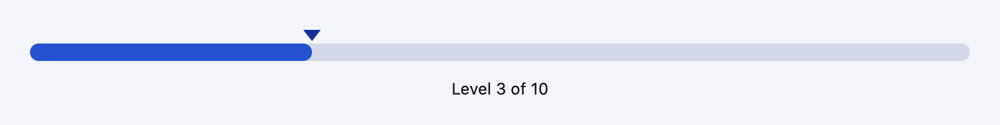
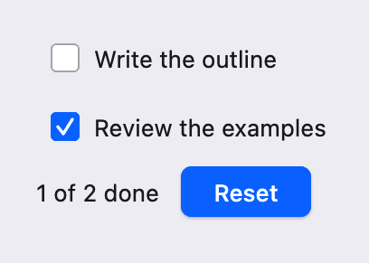
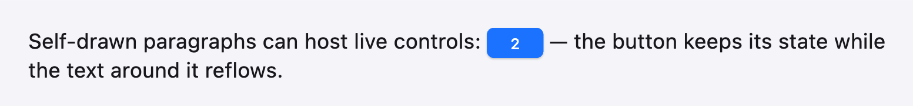
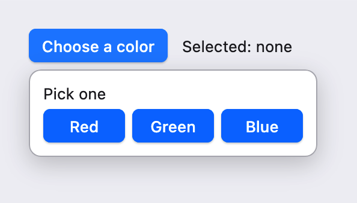

# UI 教程：自绘元素

本篇是 UI 教程的第 16–18 章。前面各章用的 Button、Checkbox、ScrollArea、Popover 都来自 `scoop.ui.component`，而它们本身也只是普通 Scoop 代码，建立在 `scoop.ui` 公开的同一套接口之上。本篇介绍这套接口：第 16 章从零写一个自绘控件，第 17 章让它获得焦点、主题外观和文字排版，第 18 章编写自己的弹层、滚动容器和按需构建的长列表。

上一篇：[主题与样式]({{ '/ui-themes.html' | relative_url }})。下一篇：[桌面集成与异步]({{ '/ui-desktop.html' | relative_url }})。

在动手之前先判断是否真的需要自绘：能用 `frame`、`row`、`column`、`stack` 和 `styled` 组合出来的界面，就不必写 Element。需要自定义的几何形状、特殊的指针交互、自己的布局算法，或者想按需构建成千上万个子项时，才轮到本篇的内容。

## 16. 自绘 Element

### 16.1 Component 与 Element

到目前为止写的都是 **Component**：它保存状态，在 `render()` 中返回一棵 View 描述，具体的测量和绘制交给描述中的其他节点。**Element** 则是真正“干活”的节点：它自己决定尺寸、子项放在哪里、哪块区域接收输入、画什么。

在 render 中用 `element(props, create, children)` 描述一个 Element：

```scoop
return element(
    MeterInput(level.value, 10, { next -> level.value = next }),
    { props, mount -> Meter(props, mount) },
    [caption]
)
```

- `props` 是传给元素的输入，每次 render 都会生成新值；元素通过 `Props<P>.value` 读取最新输入。这里把当前级别和一个“请求修改”的回调一起传下去：元素本身不保存业务状态，只负责显示和把用户操作报告给上层。
- `create` 只在**首次挂载**时调用，创建元素实例；之后的 render 只更新 Props，实例和它的字段都保留。
- `children` 是元素的子 View，元素在布局时按下标测量和放置它们。不需要 Props 时可以写 `element({ mount -> MyElement(mount) }, children)`。

Element 类继承 `Element<L>`，`L` 是 measure 交给 scene 的布局数据类型，没有额外数据时用 `Unit`。

### 16.2 一个完整的自绘控件

下面的程序画了一个可以点击或拖动的级别条：蓝色填充用弹簧动画跟随当前级别，上方三角形标出位置，下方是一个普通的 Label 子项。它只使用 `scoop.ui` 及下层的图形、Surface 接口；Label 来自控件库，只是作为子项演示。

```scoop

```

```sh
scoop run ui-custom-meter.scoop --release
```

{: .screenshot width="800"}

Windows 写作 `sco run ui-custom-meter.scoop --release`。在条上点击或按住拖动，下面的文字立即变成新的级别，填充部分则以弹簧动画滑到新位置。

接下来按生命周期的顺序拆解这个程序。

### 16.3 生命周期：onMount、update、onUnmount

| 阶段 | 调用时机 | 适合做什么 |
| --- | --- | --- |
| 构造 | 首次挂载，`create` 被调用 | 初始化不需要窗口的普通字段 |
| `onMount()` | 节点挂入窗口后、首次测量前 | 创建 Path、图片等资源，输入区域，动画，焦点目标 |
| `update()` | 每次挂载完成后，以及每次收到新 Props 后 | 把新输入同步到资源和动画上，返回需要重做的工作 |
| `onUnmount()` | 节点卸载前 | 释放没有交给 scope 管理的东西（多数情况下不需要） |

`update()` 返回 `UiInvalidation`：`Layout` 表示尺寸或子项位置可能改变，需要重新 measure；`Scene` 表示只需要重新绘制；`None` 表示什么都不用做。Meter 的新级别只影响填充宽度，所以返回 `Scene`。

`onMount()` 中创建的东西都交给 `ComponentScope` 管理：

- `scope.resource { ... }` 登记任何 `Closeable` 资源，例如 `path { ... }` 构造的 Path，或图片、缓存；
- `scope.createArea(...)` 创建输入区域；
- `scope.animation(initial)` 创建绑定到窗口时间轴的 `Animatable`。

卸载时，作用域会先停用输入和动画、调用 `onUnmount()`，再按登记的相反顺序关闭资源。所以示例中不需要为每个资源写 `use` 或在 `onUnmount()` 中手动关闭。不要在 measure、scene 或 draw 中创建资源——它们每帧都可能执行，会造成泄漏。

### 16.4 measure：约束、尺寸与子项

`measure(context, constraints)` 回答两个问题：我有多大，子项放在哪里。

`Constraints` 给出允许的宽高范围：`minWidth`、`maxWidth: Double?`、`minHeight`、`maxHeight: Double?`，最大值为 `None` 表示不限制。`constraints.constrain(size)` 把期望尺寸夹到范围内，`Constraints.tight(size)` 构造一个固定尺寸的约束。根元素收到的是窗口尺寸的固定约束，所以 Meter 总是和窗口一样大，它把 96 点高的内容区放在垂直居中的位置。

子项通过 `MeasureContext` 处理：

1. `context.measureChild(index, constraints)` 测量第 `index` 个子项，返回它的 `LayoutMetrics`（尺寸和可选的基线）；
2. `context.placeChild(index, origin)` 把子项放在本元素局部坐标中的 `origin`。

一个子项在放置前可以用不同约束重复测量（例如先试探自然宽度再决定），每个子项本帧最多放置一次。没有放置的子项保持挂载和状态，只是这一帧不绘制、不接收输入。Meter 给 Label 一个与轨道同宽的约束，并让 Label 自己用 `settings { alignment = TextAlignment.Center }` 居中文字。

measure 返回 `LayoutResult(metrics, data)`。`metrics` 是 `LayoutMetrics(size, alphabeticBaseline, ...)`；`data` 是类型为 `L` 的布局数据，会原样交给 scene。如果布局数据持有需要关闭的资源，可以传第三个参数 `dispose`，在这份布局被替换时调用。

### 16.5 scene：输入区域、子项与绘制顺序

`scene(context, layout)` 用 `SceneContext` 描述这一帧的画面，它会按调用顺序执行：

- `context.place(area, rect)`：把输入区域放到局部坐标的矩形（或 Path）上。区域的命中范围以这里为准，而不是看画了什么；
- `context.draw { paint -> ... }`：提交一段绘制；
- `context.children()`：在此处绘制所有已放置的子项。

在 `children()` 前后各写一个 `draw` 块，就得到“背景—子项—前景”三层：Meter 先画轨道和填充，再画 Label，最后画三角形，所以三角形总在最上面。

SceneContext 还提供作用于后续内容（包括子项和输入区域）的变换和裁剪：`translate`、`scale`、`rotate`、`concat(transform)`、`clipRect`、`clipPath`，以及配对使用的 `save()`/`restore()`、`saveLayer(opacity, filter)`。用 `withState { local -> ... }` 可以把这些修改限制在一个块里。下面的元素只显示子项左侧移去 10 点后、宽 120 点的部分：

```scoop
/** Shows only the part of its child that fits a 120x40 window, shifted left by 10. */
class Peek(scope: ComponentScope): Element<Unit>(scope) {
    public override fun measure(context: MeasureContext, constraints: Constraints): LayoutResult<
        Unit
    > {
        context.measureChild(0L, Constraints())
        context.placeChild(0L, Point(0.0, 0.0))
        return LayoutResult(LayoutMetrics(constraints.constrain(Size(120.0, 40.0))), Unit)
    }
    public override fun scene(context: SceneContext, layout: Unit) {
        context.withState {
            local ->
            local.clipRect(Rect(0.0, 0.0, 120.0, 40.0))
            local.translate(-10.0, 0.0)
            local.children()
        }
    }
}
```

注意区分两种变换：在 SceneContext 上做的变换会同时影响绘制和之后登记的命中区域；在 `draw` 块内部对 Canvas 做的 `save`/`translate`/`restore` 只影响这一段绘制。Meter 画三角形时用的是后者，它不需要改变点击范围。

### 16.6 draw：PaintContext 与 Canvas

`draw` 块收到 `PaintContext`，其中 `paint.canvas` 是本帧的 `Canvas`，`paint.size` 是元素尺寸，`paint.time` 是本帧时间。示例用到的 Canvas 方法有 `clear(color)`、`drawRoundRect(rect, rx, ry, paint)`、`drawCircle(center, radius, paint)`、`drawPath(path, paint)` 和 `save`/`translate`/`restore`；`Paint(color)` 默认填充，`Paint(color, PaintingStyle.Stroke, width)` 描边。

Canvas 只在当次回调中有效，不能保存到字段里留到以后使用。draw、scene 和 measure 中也不能写 State，否则会报错；要改变状态，应该在输入回调或生命周期方法中进行。

### 16.7 输入与动画

`scope.createArea(focusable, textInput, parent, handler)` 创建一个 `InputArea`，`handler(context, event)` 接收路由到这个区域的事件。事件按阶段传递，`context.phase` 是 `RoutedPhase` 之一：`Capture`（从外向内）、`Target`（到达目标区域）、`Bubble`（从内向外）、`Default`（路由结束后的默认动作）和 `Notification`（状态通知）。Meter 只处理自己作为目标时的指针事件：

```scoop
private fun handle(current: RoutedEventContext, event: InputEvent) {
    if (current.phase != RoutedPhase.Target)
        return
    when (event) {
        case Pointer(InputPointerEvent.Button(_, MouseButton.Left, val button, _)) -> {
            dragging = button == ElementState.Pressed
            if (dragging)
                pick(current.localPosition!!)
            current.consume()
        }
        // ...
    }
}
```

`current.localPosition` 是指针在区域局部坐标中的位置，`current.consume()` 表示事件已处理。处理器里调用的 `props.value.onChange(next)` 修改了上层组件的 State，上层重新 render，新 Props 到达后 `update()` 被调用。

动画用 `scope.animation(initial)` 创建，返回 `Animatable<T>`（支持 `Double`、`Point`、`Size`、`Color`）。`animateTo(target, AnimationSpec.Spring())` 从当前值开始向目标运动，`target` 是目标值，`value` 是本帧的采样值。在 scene 中读取 `fill!!.value`，框架在动画进行期间自动安排后续帧，并直接重新执行 scene，不会重跑上层的 render。

### 16.8 停帧：静止时什么都不做

Scoop UI 只在有事要做时才绘制：State 改变、Props 更新、显式的帧请求或活动动画。没有这些时，框架不遍历组件树，窗口不请求新帧，CPU 占用为零。Meter 的动画结束后就停在最后一帧，直到下一次点击。

自绘时要配合这个原则：

- 不要在 draw 中启动动画或请求帧，也不要用定时器“每帧刷新”；
- 只有视觉变化而没有状态变化时（例如悬停高亮），在输入回调中调用 `scope.requestFrame()` 请求一帧，或者使用下一章的交互助手；
- 尺寸变化需要重新布局时调用 `scope.requestLayout()`，或在 `update()` 中返回 `Layout`。

## 17. 让自绘控件接入框架能力

本章编写一个“任务行”控件：左边是主题风格的复选框标记，右边是标题；整行可以点击、悬停时显示背景、能用 Tab 聚焦并用空格键切换。

```scoop

```

```sh
scoop run ui-custom-task.scoop --release
```

{: .screenshot width="204"}

点击一行切换勾选，下面的计数随之变化；鼠标悬停时整行显示圆角背景。按 Tab 在两行和 Reset 按钮之间移动焦点，聚焦的行在标记上显示主题的焦点环，按空格或回车切换。

### 17.1 可聚焦：focusTarget

要让元素参与键盘焦点，需要两步：

1. 创建可聚焦的输入区域：`scope.createArea(focusable = true)`；
2. 用 `scope.focusTarget(area, options)` 把它登记为焦点目标。

登记后它就和内置控件一样出现在 Tab 顺序中。`FocusOptions(handle, tabStop, order)` 中，`handle` 是可选的 `FocusHandle`，用于在程序中调用 `requestFocus()` 或查询 `hasFocus`；`tabStop = false` 使它只能被点击或程序聚焦；`order` 默认为 0，相同值按挂载顺序排列。区域本身提供 `isFocusActive`、`isFocusVisible` 等查询：通常只在键盘导航时（`isFocusVisible`）才显示焦点环。

### 17.2 交互助手

指针按下、拖出取消、空格键在松开时才触发……这些细节每个按钮类控件都要处理。`scoop.ui` 把它们做成了可以直接使用的助手，都通过 ComponentScope 创建并随挂载自动关闭：

| 助手 | 用途 |
| --- | --- |
| `scope.press(area, options) { ... }` | 点击、空格、回车激活；`interaction` 给出 hovered／pressed／focused／focusVisible |
| `scope.drag(area, options, accepts) { event -> ... }` | 拖动手势 |
| `scope.presence(open, options)` | 打开／关闭的呈现阶段和 0–1 的进入／退出进度 |
| `scope.hover(trigger, open, options)` | 悬停一段时间后打开、离开后关闭，处理触发区和弹层之间的移动 |
| `scope.activeItems(source, active, options, reveal)` | 列表中的“当前项”随方向键移动，焦点留在原处（例如组合框） |
| `scope.typeahead(source, currentKey, onMatch, options)` | 非编辑列表中按字母快速跳转 |
| `scope.keyNavigation(options)` | 一组焦点目标之间的方向键与 Home／End 导航 |

TaskToggle 用的是 `scope.press`：

```scoop
val region = scope.createArea(focusable = true)
area = Some(region)
// Joins Tab order together with the ordinary controls around it.
scope.focusTarget(region)
// Click, Space and Enter activation, with hover/pressed/focus state.
press = Some(scope.press(region) { props.value.toggle() })
```

`press.interaction` 是一个 State；在 scene 中读取它，状态变化时框架会自动重新绘制这个元素，无需手动 `requestFrame()`。

### 17.3 用 ThemePainterCache 画主题部件

自绘控件不需要自己模仿各套主题的复选框。主题提供“几何查询”，`ThemePainter` 按同一份几何绘制：

- `theme.checkboxMetrics(options, direction)`：建议尺寸、最小尺寸、焦点外扩等，用于 measure；
- `theme.checkboxGeometry(bounds, visual, options, direction)`：给定最终位置，算出外框、标记线段、焦点环；
- `painter.drawCheckbox(canvas, geometry, visual)`：在 Canvas 上绘制。

`visual` 是 `CheckboxVisual(mark, interaction)`：`mark` 为 `CheckMark.Off`、`On` 或 `Mixed`，`interaction` 是 `InteractionVisual(enabled, hovered, pressed, focusVisible, ...)`。表面（`surfaceGeometry`／`drawSurface`）、单选框（`radioGeometry`／`drawRadio`）和滚动条（`scrollbarGeometry`／`drawScrollbar`）用法相同。

Painter 会持有原生资源，由 `ThemePainterCache` 管理：在 onMount 中 `scope.resource { ThemePainterCache() }`，绘制时调用 `painters.get(theme)`。主题换了，`get` 会创建新 painter 并关闭旧的。主题通过 Props 传入（TaskList 在 render 中读取 `this.theme.current.value` 并放进 `TaskInput`），所以切换主题时每一行都会收到新 Props；在 `update()` 中先调用一次 `painters!!.get(props.value.theme)`，让替换发生在绘制之前。

### 17.4 用 StylePainter 套用公共 Style

第 15 章的 `Style`（背景、边框、圆角、阴影、内容效果）也可以在自绘元素里使用。在 onMount 中 `scope.resource { StylePainter() }`，在 scene 中：

```scoop
decoration!!.scene(context, rowStyle) {
    content ->
    content.draw {
        paint -> painters!!.get(input.theme).drawCheckbox(paint.canvas, geometry, visual)
    }
    content.children()
}
```

`StylePainter.scene(context, style) { content -> ... }` 先画阴影和背景，再执行回调中的内容（并应用 `contentEffects`），最后画边框，顺序与 `styled` 完全相同。回调收到的仍是 SceneContext，可以继续 `draw` 和 `children()`。TaskToggle 根据悬停状态选择有无背景色，圆角取自主题的 `tokens.corners.medium`。另有 `scene(context, bounds, style) { ... }` 指定矩形，以及 `paint(canvas, bounds, style)` 供离屏绘制使用。

### 17.5 文本：ParagraphHost 与行内子项

在自绘元素中排版文字，使用 `scoop.ui.text` 的 `ParagraphHost`。它负责段落布局、文字绘制和缓存，还能把普通 UI 子项（按钮、图片、徽标）嵌入文字中，像一个“字”一样参与换行和基线对齐：

```scoop

```

```sh
scoop run ui-custom-paragraph.scoop --release
```

{: .screenshot width="776"}

窗口中是一段文字，中间嵌着一个显示计数的蓝色按钮；点击按钮计数增加。把窗口拉窄，文字重新换行，按钮随文字移动，计数保持不变。

几个要点：

- `inlineText { ... }` 用 `text(...)` 和 `inline(key, view, alternateText)` 构造内容；`InlineKey` 把文字中的占位和子 View 对应起来，`alternateText` 用于复制等场合。它产生 `content`（StyledText）和 `inlines`（`InlineView` 数组）。
- 描述元素时，用 `inlineChildren(content, inlines)` 生成 children，顺序与文字中的占位一致。
- Element 在 onMount 中 `scope.resource { ParagraphHost() }`；measure 中调用 `host.measure(context, constraints, fonts, content, settings, inlines)`，它会测量并放置行内子项，返回 `ParagraphMeasurement`；scene 中调用 `host.scene(context, measured)` 绘制文字和子项。`ParagraphMeasurement` 需要关闭，所以作为布局数据返回时传入 `{ measured.close() }`。
- `scope.defaultFonts` 是窗口的默认字体集合。
- 行内子项默认按自然尺寸测量。Button 会占满给它的宽度，所以示例用 `size = Some(Size(48.0, 26.0))` 给了固定尺寸。

文字或子项变化时，ParagraphHost 会尽量复用已有布局；行内子项的 key 稳定，换行和重排都不会让按钮丢失状态。

### 17.6 绘制缓存：drawLayer

普通的 `draw` 块每次绘制都会执行。如果一块内容绘制成本较高、且有可靠的“版本号”，可以用 `drawLayer` 缓存它：

```scoop
/** A badge whose pixels depend only on its count. */
class Badge(private val props: Props<Int>, scope: ComponentScope): Element<Unit>(scope) {
    private val paintKey = PaintKey()

    public override fun measure(context: MeasureContext, constraints: Constraints): LayoutResult<
        Unit
    > = LayoutResult(LayoutMetrics(constraints.constrain(Size(40.0, 40.0))), Unit)

    public override fun scene(context: SceneContext, layout: Unit) {
        val count = props.value
        // The revision must change whenever anything drawn inside the block changes.
        context.drawLayer(paintKey, Rect(0.0, 0.0, 40.0, 40.0), count.toLong()) {
            paint ->
            val color =
                if (count > 9)
                    Color(0.86, 0.18, 0.16)
                else
                    Color(0.18, 0.42, 0.85)
            paint.canvas.drawCircle(Point(20.0, 20.0), 18.0, Paint(color))
        }
    }
}
```

- `PaintKey` 由元素持有，每个 key 在一次 scene 中只能使用一次；
- `bounds` 是缓存的范围，回调在独立的局部坐标中绘制；
- `revision` 必须覆盖所有影响像素的输入：状态、时间、动画、主题和资源。这里像素只取决于 `count`，所以直接用它。忘记把某个输入算进版本号，画面就会停留在旧内容上。

缓存只节省绘制；场景、输入区域和子项每帧照常装配。拿不准时就用普通 `draw`，ParagraphHost 等内置部件已经在内部使用了这套机制。

## 18. 自定义弹层与容器

### 18.1 portal 与锚点

`portal(open, content) { ... }` 把一个 View 送到窗口的弹层出口中显示。它在原位置只占约束允许的最小尺寸，内容越过祖先的裁剪和变换，画在页面之上；但在逻辑上仍属于原来的组件树，输入路由、Tab 顺序和状态都跟着原位置走。`open` 是 `Binding<Boolean>`，与第 11 章的控件弹层一样，它是“是否打开”的唯一来源。

要让弹层贴着某个元素出现，需要一个 `LayoutAnchor`：

1. 创建一个 `LayoutAnchor()`，保存在组件字段里；
2. 在触发器所在 Element 的 `onMount` 中调用 `scope.layoutAnchor(anchor)`；
3. 在它的 `scene` 中调用 `context.anchor(anchor, rect)` 报告位置；
4. 在 portal 的配置中写 `anchored(anchor) { ... }`，即 `OverlayPlacement.Anchored`。

下面是一个完整的颜色选择弹层：

```scoop

```

```sh
scoop run ui-custom-popover.scoop --release
```

{: .screenshot width="297"}

点击 Choose a color，下方出现带阴影的卡片；点击卡片空白处不会关闭，点击某个颜色后关闭并更新右侧文字；点击窗口其他位置或按 Escape 也会关闭。

示例中有两个很小但很常用的 Element：

- `AnchorBox` 原样测量、放置唯一的子项，并在 scene 中把自己的矩形报告为锚点。锚点使用当前的变换和裁剪换算到窗口坐标，不需要输入区域。
- `PanelArea` 给卡片铺一个覆盖整个面板的输入区域，并用 `scope.routeChildren(area)` 让子项的事件经过它。“外部点击”按逻辑子树判断：点在面板的内边距上时，如果那里没有任何属于弹层的输入区域，就会被当成外部点击而关闭弹层。

portal 的常用配置：

- 定位：`anchored(anchor) { preferredSide; alignment; gap; viewportPadding; matchAnchorWidth }`；`viewport { horizontal; vertical }` 在窗口中对齐（例如居中的对话框，这是默认值）；`atPoint(point) { ... }` 以窗口坐标定位，适合右键菜单。定位会先给内容有界的约束，再按实际尺寸在空间不足时翻转到另一侧或平移；弹层内的元素可以在 scene 中通过 `context.overlayLayout` 读取最终的 `bounds`、`anchor` 和 `side`，例如用来画指向锚点的箭头。
- 关闭：`dismiss { escape = true; outsidePress = OutsidePress.CloseAndConsume }`，默认两者都不关闭。`CloseAndContinue` 在关闭的同时让被点中的控件继续收到这次按下（只适用于非模态）。每次只关闭最上层的适用弹层。
- 其他：`onCloseRequest` 可以拒绝用户发起的关闭，`onClosed` 在弹层真正移除后调用，`transition` 配置进入／退出动画，`anchorVisibility` 决定锚点被滚出视野时关闭、隐藏还是保持显示。

### 18.2 模态弹层

把 `mode` 设为 `OverlayMode.Modal` 就得到同窗口模态：打开时保存原焦点并屏蔽背景输入，Tab 只在弹层内循环；关闭后焦点回到原来的位置。`focus { initialFocus = Some(handle) }` 指定打开后聚焦的控件：

```scoop
val layer =
    portal(open.binding(), dialog) {
        mode = OverlayMode.Modal
        focus { initialFocus = Some(confirm) }
        dismiss { escape = true }
    }
```

这里 `confirm` 是一个 `FocusHandle`，通过 `button("Delete", { ... }) { focus { handle = Some(confirm) } }` 交给对话框中的按钮。遮罩、面板外观和布局都由你放进 `dialog` 的内容决定。另有 `OverlayMode.FocusContained`：焦点限制在弹层内，但不屏蔽背景的指针输入。

### 18.3 自定义滚动容器与按需列表

最后编写一个固定行高、一万行的列表。它同时演示两件事：用 `ScrollViewport` 实现滚动，用 `LazyElement` 只构建看得见的行。

```scoop

```

```sh
scoop run ui-custom-list.scoop --release
```

用滚轮或触控板滚动，行号连续变化；无论滚到哪里，任何时刻都只有可见的十几行被构建和挂载。

**数据源：`ItemSource`。** 它提供 `count`、`keyAt(index)`、`indexOfKey(key)` 和 `build(index)`。key 必须稳定且唯一（`ViewKey.Text` 或 `ViewKey.Number`）；数据变化时换一个新的 ItemSource 快照。框架只对实际访问到的下标调用 `build`，不会预先构建全部行；已构建的行仅因滚动而重新测量时，也不会重跑 `build`。

**按需容器：`lazyElement(source, props, create)` 与 `LazyElement<L>`。** 生命周期和 scene 与 Element 相同，区别是 measure 收到 `LazyMeasureContext`：

- `context.itemCount` 是条目总数；
- `context.measureItem(index, constraints)` 按需构建、挂载并测量第 `index` 项；
- `context.placeItem(index, origin)` 放置它，之后本帧不能再测量或放置同一项；
- `context.pinnedItems` 列出必须保留的条目，例如持有焦点、正在等待聚焦、正在被按下或拖动的行。即使它们滚出了可见范围，也要测量和放置，否则交互会被打断；视口裁剪会让它们不可见。

本帧没有被测量放置的条目会被卸载。第四个参数 `retention` 可以设为 `ItemRetention.KeepAlive(maxOffscreenItems)`，额外保留若干个最近离开的实例，滚回来时复用它们的状态。

**滚动：`ScrollState` 与 `ScrollViewport`。** `ScrollState` 是普通的业务对象，保存最近一次成功呈现的 `offset`、`viewport`、`content` 尺寸，提供 `scrollTo`、`scrollBy`、`reveal` 和 `animateTo`。自绘容器在 onMount 中用 `scope.scrollViewport(state)` 把它绑定到自己，然后：

1. 在 measure 中调用 `viewport.layout(viewportSize, contentSize)`，得到本帧的 `ScrollLayout`，其中 `snapshot.offset` 是本帧使用的滚动位置。FixedRows 据此算出可见的行号范围；
2. 在 scene 中调用 `viewport.present(context, layout, Some { content -> content.children() })`。回调中的内容自动被裁剪到视口，并按滚动偏移平移；子项放在内容坐标中即可（第 `i` 行放在 `y = i × 行高`）。滚动条等固定装饰画在回调之外。

滚轮输入要自己接：FixedRows 在区域的默认动作中处理 `InputPointerEvent.Wheel`，用 `current.consumeScroll(lineStep) { amount -> ... }` 把行或像素增量换算成位移，交给 `state.scrollBy(delta, ScrollOrigin.User)`，并返回实际消耗的部分，剩余部分会继续交给外层的滚动容器。放在默认动作中，是为了让行内的子控件有机会先处理这次事件。

行高可变的容器常常在内容测量之后才知道应该滚到哪里，例如保持当前阅读位置不跳动。这时可以在布局中构造 `ScrollAdjustment(state.requestRevision, offset)` 作为 `viewport.layout` 的第三个参数：它只在定位意图仍是同一次请求时生效，新的滚动请求和正在进行的动画优先。

**按 key 聚焦：`scope.lazyFocus(viewport)`。** 对于没有构建的行，无法预先拿到它们的 FocusHandle。`LazyElement` 可以在 onMount 中登记 `scope.lazyFocus(viewport, options)`，之后用 `requestFocus(key, ItemFocusEdge.First)` 请求聚焦某个 key 对应的行：对应条目会加入 `pinnedItems`，容器通过 `pendingItem` 得知需要先把它滚到可见位置。`LazyFocusOptions` 还可以让整个列表只占一个 Tab 停靠点、用方向键在行之间移动。控件库中的 VirtualList 就是这样实现的，需要完整的键盘行为时，直接使用它（见[焦点、键盘与滚动]({{ '/ui-focus-scroll.html' | relative_url }})）通常更合适。

## 常见错误与继续阅读

| 现象 | 原因与处理 |
| --- | --- |
| 运行时报不能在 measure／scene／draw 中写 State | 这些阶段必须是纯计算；在输入回调或 `update()`／`onMount()` 中修改状态 |
| 点击自绘区域没有反应 | 区域没有在 scene 中 `context.place(area, rect)`，或处理器检查的阶段不对：作为目标的指针事件在 `RoutedPhase.Target` 阶段到达 |
| 悬停或焦点变化后画面不更新 | 这些变化不会触发 render；读取 `scope.press(...).interaction`，或在回调中调用 `scope.requestFrame()` |
| 内存或句柄持续增长 | 在 scene／draw 中创建了 Path、图片或 painter；改到 onMount 中用 `scope.resource { }` 登记 |
| 动画结束后窗口仍在持续重绘 | 在 draw 中调用了 `animateTo` 或 `requestFrame()`；只在 `update()` 或输入回调中启动动画 |
| 子项没有显示 | measure 中测量了子项但忘记 `placeChild`，或 scene 中没有调用 `children()` |
| `drawLayer` 显示旧内容 | `revision` 没有覆盖所有影响像素的输入 |
| 在 builder 块中写 `anchored(anchor)`、`label(...)` 等时报 “implicit use of an outer receiver” 或类型为 `Unit` | 先把组件字段取到局部变量（`val anchor = this.anchor`）；需要 View 值时在块外构造 |
| 点弹层的内边距也会关闭弹层 | 弹层面板没有覆盖整个面板的输入区域；像 `PanelArea` 那样创建区域并 `routeChildren` |
| 列表滚走后正在编辑或聚焦的行丢失状态 | 没有测量和放置 `context.pinnedItems` 中的条目 |

下一篇[桌面集成与异步]({{ '/ui-desktop.html' | relative_url }})介绍菜单栏、托盘、多窗口和后台任务。本篇所用接口的完整合同见 Scoop 仓库的 [UI 规范](https://github.com/scoop-lang/scoop/tree/main/docs/specs)；工具链中的 `scoop.ui/examples/custom` 是一个只依赖框架的自绘 Counter，`scoop.ui.component` 的源码则展示了全部内置控件如何基于这些接口实现。以上示例在 macOS 上验证，Linux 上用法相同。
