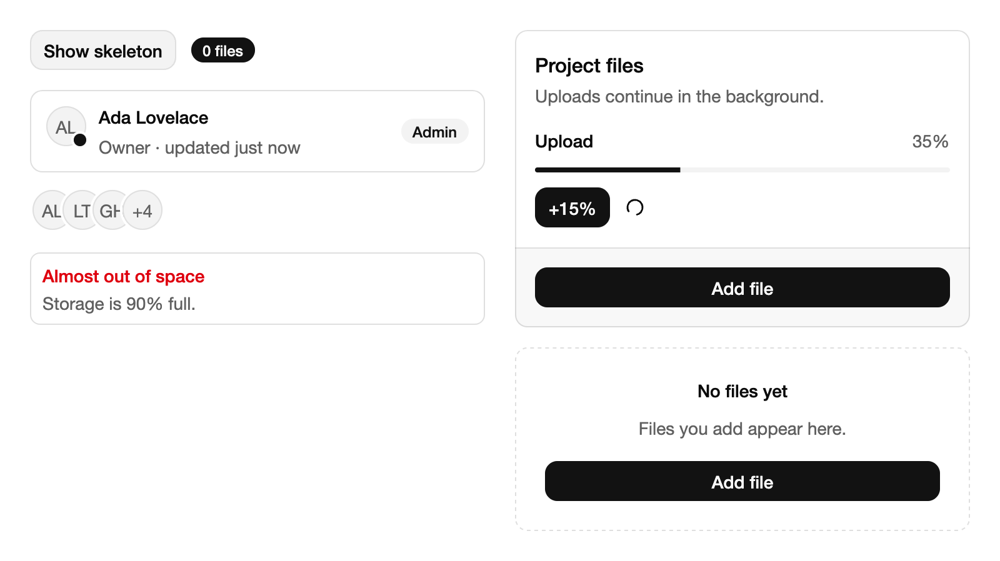
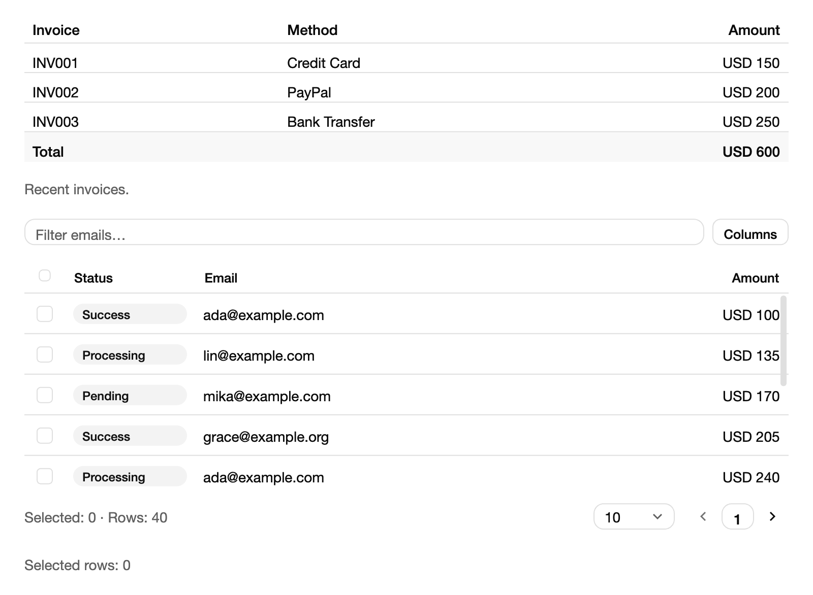
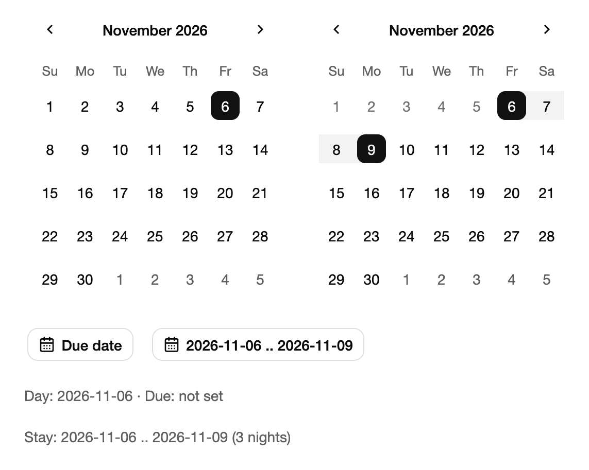
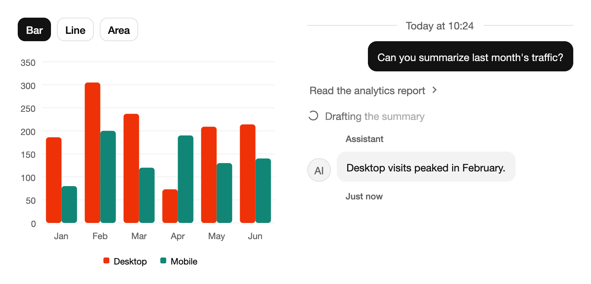

# UI 教程：数据展示

本篇是 UI 教程的第 13 章，介绍把数据呈现给用户的控件：从卡片、提示和加载状态这些“内容块”，到可排序、筛选、分页的表格，再到日历、日期选择器、图表和聊天式的会话组件。

上一篇：[弹层与导航]({{ '/ui-overlays.html' | relative_url }})。下一篇：[主题与样式]({{ '/ui-themes.html' | relative_url }})。

示例沿用上一篇的结构：状态放在模型类中，页面函数 `xxxPage(model, theme)` 构建界面，根 `frame` 用主题的页面底色铺底；需要把控件当作值传递时，用 `import scoop.ui.component.xxx as makeXxx` 调用顶层函数。

## 13. 数据展示

### 13.1 内容块：卡片、提示、条目与加载状态

这一组控件都接收一个完整的正文 View，再用配置块补充标题、描述和其他区域：

| 控件 | 写法 | 用途与常用配置 |
| --- | --- | --- |
| Card | `card(content) { title(...); description(...) }` | 一组相关内容；`footer(view)`、`action(view)`、`header(view)`，`size = CardSize.Sm` |
| Alert | `alert(content) { title(...) }` | 页面内的提示条；`variant = AlertVariant.Destructive`、`icon(view)` |
| EmptyState | `emptyState(content) { title(...) }` | 没有数据时的占位；`outlined = true` 显示虚线边框，`media(view)` 放图标 |
| Item | `item { title(...); description(...) }` | 列表中的一行；`media(view)`、`actions(view)`，`variant = ItemVariant.Outline` |
| Avatar | `avatar("AL") { badge() }` | 头像，没有图片时显示文字；`avatarGroup { avatar(...); count(4L) }` 叠放多个 |
| Badge | `badge("Admin")` | 小标签，`variant` 与按钮相同 |
| Skeleton | `skeleton(content) { loading = pending }` | 加载占位；正文保持挂载，加载期间只隐藏 |
| Progress | `progress(Some(35.0)) { label(...); showValue = true }` | 进度条；`progress(None)` 表示总量未知 |
| Spinner | `spinner { running = busy }` | 不确定时长的忙碌指示 |

`title` 和 `description` 既可以传字符串，也可以传 `StyledText` 或任意 View。在 `column { }` 这类容器块中，Item 对应的成员名是 `contentItem`，因为 `item` 在容器块里已经用来设置子项的伸缩参数。

保存为 `ui-data-content.scoop`（[下载](examples/ui-data-content.scoop)）：

```scoop

```

```sh
scoop run ui-data-content.scoop --release
```

{: .screenshot width="800"}

Windows 写作 `sco run ui-data-content.scoop --release`，本篇其余命令同理。

窗口分为左右两栏。左栏开始时是一块灰色的骨架占位，点 Reveal content 后显示 Ada Lovelace 的资料条目（带头像状态点和 Admin 标签）以及一组叠放的头像；下面是红色标题的存储空间提示。右栏的 Project files 卡片中有 35% 的上传进度条和一个转动的 Spinner：每点一次 +15% 进度增加，到 100% 时 Spinner 停止。卡片页脚和下方空状态里的 Add file 按钮会增加顶部标签中的文件数，数量大于 0 后空状态消失。

两点说明：

- **Skeleton 不会重建正文。** `skeleton(profile) { loading = ... }` 在加载期间仍然挂载并测量 `profile`，只是不绘制、不接收输入，所以切换前后占位尺寸一致，正文里的组件状态也不会丢失。只需要一块占位形状时，用无正文的 `skeleton { width = Some(220.0); height = Some(12.0) }`，`shape = SkeletonShape.Circle` 画圆形。
- **进度值按 `minimum`～`maximum` 归一化**，默认 0～100。数值变化时进度条有过渡动画；Spinner、Skeleton 和不确定进度在停止、隐藏或卸载后不再请求动画帧。

### 13.2 表格

表格控件分两种：

- **`table { header { }; body { }; footer { } }`** 用于行数有限、内容固定的展示，例如发票明细。`head(...)` 写表头单元格，`row(key) { cell(...) }` 写数据行，`cell(...) { span = 2L }` 跨列，`caption(...)` 加表格说明；`columns = Some([...])` 可指定各列宽度。
- **`dataTable(state)`** 用于需要排序、筛选、分页、选择和调整列宽的数据集。

`dataTable` 的数据和查询状态都保存在应用持有的 `DataTableState<Row>` 中，由三部分组成：

1. **行数据** `TableData.Local(rows)`：`rows` 是 `TableRows`，每一行是一个 `TableRecord(key, value)`，key 必须稳定且唯一，表格靠它在排序、翻页和数据更新后保持选择与行内编辑状态。
2. **列定义** `TableColumn(id, header, cell, size, ...)`：`cell` 是 `(Row) -> View`；提供 `compare` 的列可以点击表头排序，提供 `filter` 的列可以通过 `setFilter(id, text)` 筛选；`alignment` 控制单元格对齐。
3. **列宽** `TableColumnSize(track, minimum, ...)`：`track` 是 `GridTrack.Fixed(120.0)`、`GridTrack.Auto`（按内容，可用 `samples` 给出代表性文字）或 `GridTrack.Fraction(1.0)`（分配剩余宽度）。

保存为 `ui-data-table.scoop`（[下载](examples/ui-data-table.scoop)）：

```scoop

```

```sh
scoop run ui-data-table.scoop --release
```

{: .screenshot width="800"}

窗口上方是三行发票和 Total 合计行组成的固定表格；下方是付款数据表：工具栏左侧是筛选框，右侧的 Columns 菜单可以隐藏列。每行左侧有选择框，底部显示 `Selected: 0 · Rows: 40`、每页行数选择和翻页按钮。可以这样试：

- 在筛选框输入 `lin`，只剩 lin@example.com 的行，行数变为 10；
- 点 Amount 表头按金额升序排序，再点一次改为降序；
- 勾选一行，底部的 `Selected rows` 随之变化——它直接读取 `payments.selectedKeys`，说明表格状态是普通的可观察状态；
- 拖动表头之间的边界调整列宽。

筛选框的 `onEdited` 在文字确认修改后调用 `setFilter`，这里用的 `contains` 来自 `scoop.text`，需要单独导入。表格只挂载可见的行，数据量大时也能保持流畅。

除了用户操作，代码也可以直接改变表格状态：

```scoop
fun sortByAmount(payments: DataTableState<Payment>) {
    payments.toggleSort("amount")
    payments.setPageSize(20L)
    payments.setPage(0L)
    payments.showColumn("email", false)
    payments.selectPage(true)
}

fun replaceRows(payments: DataTableState<Payment>, items: Array<Payment>) {
    val rows =
        TableRows(
            Array<TableRecord<Payment>>(items.size) {
                index -> TableRecord(ViewKey.Number(items[index].id), items[index])
            }
        )
    payments.replaceData(TableData.Local(rows))
}
```

页码从 0 开始，默认每页 10 行；`pageSizes` 只决定下拉框里的可选项。`TableData.Local` 由表格在本地完成筛选、排序和分页；数据在服务器上时改用 `TableData.Provided(currentPage, totalRows)`，并在 `DataTableState` 的 `onQueryChange` 回调中按新的查询取回对应一页，再用 `replaceData` 交给表格。

### 13.3 日历与日期选择器

日期使用标准库 `scoop.datetime` 中的 `LocalDate`，例如 `LocalDate(2026, 11, 6)`；`plusDays`、`daysUntil` 等方法用于日期运算。日期范围是控件库提供的 `DateRange(start, end)`，`nights` 给出两端之间的天数。

日历按选择方式分三个函数，第二个参数是初次显示的月份：

- `calendar(binding, initialPage)`：单选，绑定 `LocalDate?`；
- `calendarMultiple(binding, initialPage)`：多选，绑定 `Array<LocalDate>`；
- `calendarRange(binding, initialPage)`：范围，绑定 `DateRange?`，点击两次分别确定起止日期。

配置块中，`today` 标出“今天”（标准库不读取系统日期，需要由应用提供），`rules = CalendarRules(minDate = ..., maxDate = ...)` 限制可选范围，`monthCount = 2L` 并排显示两个月，`caption = CalendarCaption.Dropdowns` 用月份／年份下拉框代替标题，`locale` 设置月份与星期的名称和一周起始日。

`datePicker(binding, initialPage)` 和 `dateRangePicker(binding, initialPage)` 把日历放进弹层：点击按钮打开，选好日期后自动关闭。日历相关的配置写在 `calendar { ... }` 子块里；`presets` 提供“未来 7 天”这类快捷选项。

保存为 `ui-data-dates.scoop`（[下载](examples/ui-data-dates.scoop)）：

```scoop

```

```sh
scoop run ui-data-dates.scoop --release
```

{: .screenshot width="571"}

窗口上方并排显示两个 2026 年 11 月的日历：左边单选，6 日被选中；右边是范围选择，6 日到 9 日高亮，6 日之前的日期因为 `minDate` 而变灰不可选。下面是 Due date 和 `2026-11-06 .. 2026-11-09` 两个按钮。点 Due date 弹出日历，选 20 日后弹层关闭，按钮和底部文字都变成 `2026-11-20`。在右侧日历上重新选择范围，范围按钮和 `Stay` 一行同步更新——两者绑定的是同一个 `model.stay`。

日历支持完整的键盘操作：方向键在日期间移动，PageUp／PageDown 翻月。需要让用户直接输入日期时，给 `datePicker` 设置 `draft = Some(DatePickerDraft())`：输入框按严格的 `YYYY-MM-DD`（范围为 `start .. end`）解析，按 Enter 提交，解析失败时保留原文供用户修改；`parser` 可以换成自己的解析函数。

### 13.4 图表与会话组件

**图表。** `chart(model) { kind = ... }` 绘制折线、面积、柱状、饼图、雷达和径向图（`ChartKind.Line`、`Area`、`Bar`、`Pie`、`Radar`、`Radial`）。数据是 `ChartData(datums, series)`：`datums` 是横轴上的类别（例如月份），每个 `ChartSeries` 是一组数值，`None` 表示缺失。数据交给 `ChartModel(data)` 持有，之后用 `model.replaceData(newData)` 更新；图例点击可以隐藏某个系列，悬停或用方向键移动时显示数值提示。常用配置有 `curve`（`Linear`、`Step`、`Monotone`）、`stack`（堆叠）、`height`、`xAxis` / `yAxis`、`legend`、`tooltip`。

**会话组件。** 用于聊天、助手对话这类界面：

- `bubble(text) { variant; align }`：消息气泡，七种外观，`align = MessageAlignment.End` 靠右；
- `message(content) { avatar; header(...); footer(...) }`：一条完整消息，组合头像、发送者和时间；
- `marker(text)`：时间分隔或状态提示，`variant = MarkerVariant.Separator` 显示两侧横线；
- `trace(title, content) { status }`、`traceLine(title) { status }`：展示助手的执行步骤，`TraceStatus` 有 `Complete`、`Running`、`Error`、`Pending`，`trace` 可以展开查看详情。

保存为 `ui-data-chart.scoop`（[下载](examples/ui-data-chart.scoop)）：

```scoop

```

```sh
scoop run ui-data-chart.scoop --release
```

{: .screenshot width="800"}

左栏是 1 月到 6 月 Desktop 与 Mobile 访问量的柱状图，下方有图例；点上方的 Line 或 Area 切换图表类型，悬停柱子显示具体数值。右栏是一段对话：顶部是 “Today at 10:24” 分隔线，用户的问题以深色气泡靠右显示；接着是可展开的 “Read the analytics report” 步骤和一个带转圈图标的 “Drafting the summary” 运行中步骤；最后是带 AI 头像、Assistant 标题和 Just now 页脚的回复。

真实的聊天应用里消息很多，需要按需挂载并在新消息到来时滚动到底部，这时用 `messageScroller(source, scrollState)` 承载消息列表，并配合 `messageScrollButton` 提供“回到最新”按钮；它们的用法和[虚拟列表]({{ '/ui-focus-scroll.html' | relative_url }})类似，完整示例见工具链源码中 `scoop.ui.component/examples/shadcn` 的会话页面。

## 常见错误与继续阅读

| 现象 | 原因与处理 |
| --- | --- |
| 在 `column { }` 中写 `item { title(...) }` 报错 | 容器块里的 `item` 是伸缩子项；内容条目用 `contentItem { ... }` 或顶层 `item` 函数 |
| 排序、翻页后选择错乱或行内输入框内容跳到别的行 | `TableRecord` 的 key 不稳定；用数据本身的 id 而不是行号 |
| 点击表头没有反应 | 该列没有提供 `compare` |
| 筛选没有效果 | 列没有提供 `filter`，或 `setFilter` 的列 id 与 `TableColumn` 的 id 不一致 |
| `String` 没有 `contains` 方法 | 导入 `scoop.text.contains` |
| f-string 中直接插入 `ChartKind` 等枚举报 “does not implement core ToString” | 写一个 `when` 把枚举转成文字 |
| 日历上没有标出今天 | 需要通过 `today = Some(date)` 显式提供 |
| 骨架切换时正文状态丢失 | 用 `skeleton(content) { loading = ... }` 包住正文，而不是用 `if` 在占位和正文之间切换 |

下一篇[主题与样式]({{ '/ui-themes.html' | relative_url }})介绍如何切换和定制主题。各控件的完整配置可以在 [API 文档](../api/index.html)中查找，工具链源码中的 `scoop.ui.component/examples/shadcn` 演示了本篇所有控件的更多用法。以上示例在 macOS 上验证，Linux 上用法相同。
