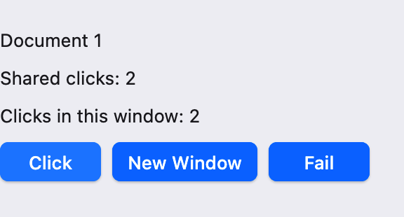
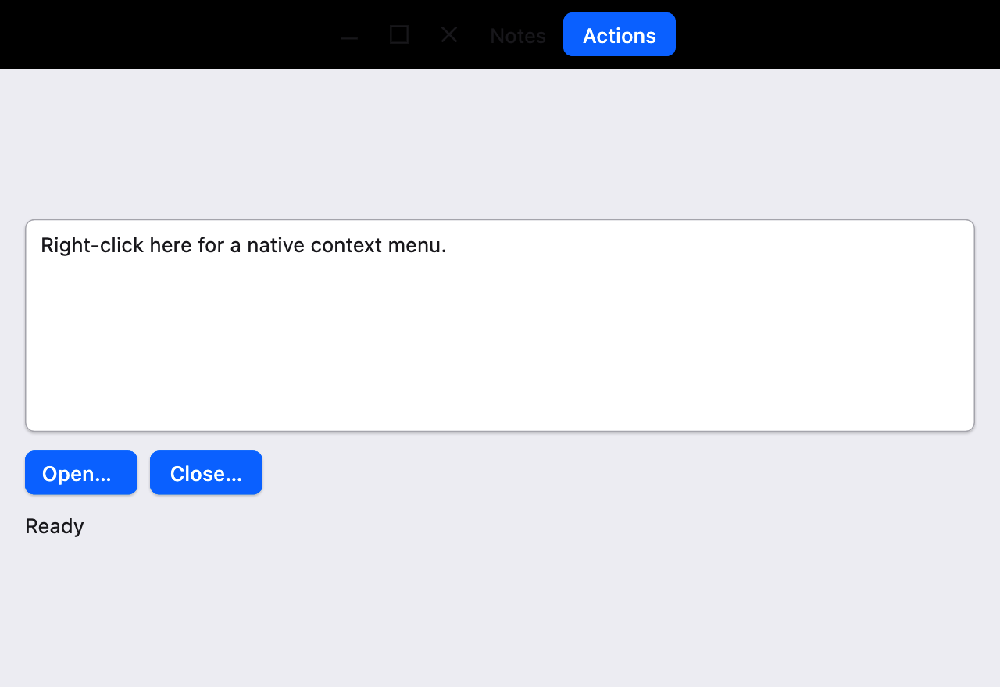
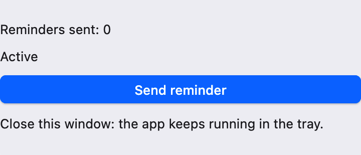
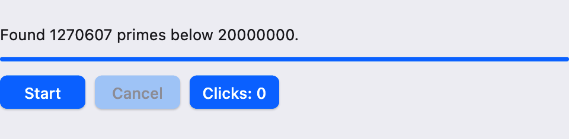

# UI 教程：桌面集成与异步

本篇是 UI 教程的第 19–21 章。前面各篇都只有一个窗口，入口是 `runUiApplication`；本篇改为显式创建 `Application` 和 `UiHost`，从而管理多个窗口、原生菜单栏和托盘，再介绍自绘标题栏、原生对话框以及后台任务。上一篇：[自绘元素]({{ '/ui-custom.html' | relative_url }})；下一篇：[测试 UI]({{ '/ui-testing.html' | relative_url }})。

本篇示例都在 macOS 上验证过。运行命令与前面相同；Windows 工具包的主驱动名为 `sco`，把命令中的 `scoop` 换成 `sco` 即可。各平台的差异在相应小节单独说明。

## 19. 应用根与多窗口

### 19.1 runUiApplication 做了什么

`runUiApplication(title, create)` 是单窗口应用的快捷入口。它大致相当于下面的几步：

1. 创建 `Application`，选项为“最后一个窗口销毁后退出”；
2. 创建 `UiHost`，在应用启动事件 `Resumed` 中新建一个窗口，并用 `host.attach(window, create)` 挂载根组件；
3. 用户点击窗口的关闭按钮时（`CloseRequested`）请求退出；
4. 用 `UiHost.use { host -> application.run(host) }` 运行事件循环，返回时关闭宿主及其中所有 UI。

只要需求超出“一个窗口、关掉就退出”，就要自己写这几步：多个窗口、应用级菜单栏、托盘、关闭前确认、退出后还要清理后台线程，或者需要 asyncio 协程（第 21 章）。

这里涉及三个对象，分工如下：

| 对象 | 来自 | 职责 |
| --- | --- | --- |
| `Application` | `scoop.window` | 一个进程只能创建一个，运行原生事件循环；`applicationOptions { ... }` 配置选项 |
| `ActiveApplication` | `scoop.window` | 事件循环运行期间可用：`createWindow`、`requestExit`、`proxy()` |
| `UiHost` | `scoop.ui` | 接收应用事件，把组件树挂到窗口（`attach`）或应用本身（`attachApplication`） |

`UiHost` 的 `handler` 参数接收 `(UiHost, ActiveApplication, ApplicationEvent)`，所有窗口的事件都从这里经过，以 `ApplicationEvent.Window(id, event)` 区分来自哪个窗口。

### 19.2 多窗口：共享状态与各自的状态

下面的程序可以打开任意多个文档窗口。每个窗口显示两个计数：所有窗口共享的点击数，以及本窗口自己的点击数。保存为 `ui-desktop-windows.scoop`（[下载](examples/ui-desktop-windows.scoop)）：

```scoop

```

```sh
scoop run ui-desktop-windows.scoop --release
```

{: .screenshot width="288"}

启动后出现标题为 `Document 1` 的窗口。点 New Window 或按 Cmd+N（Windows、Linux 上为 Ctrl+N）会再打开 `Document 2`。在任一窗口点 Click，所有窗口的 `Shared clicks` 同时加一，而 `Clicks in this window` 只在被点击的窗口中变化。菜单栏的 Window 菜单中有一项灰色的 `Open windows: 2`，它随窗口数量变化。关闭所有窗口后程序退出。

这个程序的结构是本章的重点：

- **业务对象持有共享状态**。`Workspace` 是普通类，`clicks` 和 `windowCount` 是它的 State。每个窗口的根组件都读取同一个 `workspace.clicks`，所以一处修改，所有窗口更新。`DocumentView` 自己的 `local` 则每个窗口各有一份。这与[状态与数据流]({{ '/ui-state.html' | relative_url }})中的业务 Store 是同一种做法，只是读取者分布在不同窗口中。
- **在 `Resumed` 中创建窗口**。窗口只能在事件循环运行后创建。`active.createWindow(windowAttributes { ... })` 返回原生 `Window`，再用 `host.attach(window, create)` 挂载组件。同一个 `UiHost` 可以挂载任意多个窗口根。
- **关闭按钮只是请求**。用户点击关闭按钮时，应用收到 `Window(id, WindowEvent.CloseRequested)`，窗口并不会自动消失。由应用决定怎么做：这里调用 `window.requestDestroy()` 销毁它；也可以先询问用户（见 20.5 节），或者只是隐藏。原生窗口销毁时，挂在上面的 UI 树会自动卸载。
- **`Destroyed` 之后再整理记录**。销毁是异步完成的，最终会收到 `WindowEvent.Destroyed`，这时才把窗口从列表中移除。
- **退出策略**。`applicationOptions { lastWindowPolicy = LastWindowPolicy.Exit }` 表示最后一个窗口真正销毁后退出事件循环。`Application()` 的默认值是 `LastWindowPolicy.KeepRunning`：所有窗口关闭后程序仍在运行，适合托盘应用（见 20.6 节），但普通应用忘记设置就会留下一个看不见的进程。
- **Quit 菜单项**。`MenuRole.Quit` 是标准角色，它不调用你的回调，而是产生 `ApplicationEvent.ExitRequested`。应用在这里调用 `requestExit()` 开始有序退出，也可以先弹出确认。

### 19.3 应用根：ApplicationComponent

菜单栏不属于任何一个窗口：所有窗口都关闭后它可能仍然存在，在 macOS 上它显示在屏幕顶部。这类“属于整个应用”的原生资源由**应用根**描述。

`AppMenu` 继承 `ApplicationComponent`，用 `host.attachApplication(application) { scope -> AppMenu(this, scope) }` 挂载。它与普通组件很像：

- 有 `render()`，读取 State 时同样登记依赖，State 变化后重新 render。示例中菜单项的文字 `Open windows: N` 就是这样随 `windowCount` 更新的。
- 有 `onMount`／`onUnmount`，`scope`（`ApplicationScope`）同样提供 `application`、`onDispose` 等。

区别在于它没有窗口、布局和字体，`render()` 返回的是 `ApplicationContent`，其中列出若干应用级条目，例如 `nativeApplicationMenuBar(menu, key)` 和第 20.6 节的托盘图标 `nativeTrayIcon(...)`。每个 `UiHost` 至多挂载一个应用根，可以同时有任意多个窗口根。`attachApplication` 返回 `UiApplication?`，需要时可调用它的 `close()` 只卸载应用根。

**菜单栏的平台差异。** macOS 只有一条屏幕顶部的全局菜单栏，菜单中的第一个子菜单会作为“应用菜单”显示，标题是程序名而不是你写的 `File`；把 Quit 放在第一个子菜单中符合 macOS 习惯。Windows 和 Linux 没有全局菜单栏，同一份应用菜单会附着到每个窗口上。需要某个窗口显示不同菜单时，用 `nativeWindowMenuBar(content, menu)` 包住该窗口的正文（见 20.3 节）。当前平台支持哪种方式，可以查询 `active.desktopCapabilities().menus`。

### 19.4 错误隔离：onRootError 与 onApplicationError

某个窗口的组件抛出异常时，是否要连带整个程序一起崩溃？`UiHost` 的两个参数决定这件事：

- `onRootError = { id, error -> ... }`：某个**窗口根**在挂载、render、回调等过程中失败时调用，参数是窗口 id 和异常；
- `onApplicationError = { error -> ... }`：**应用根**（菜单、托盘）失败时调用。

框架先清理失败的根——卸载组件树、注销输入和资源——再调用处理器。处理器正常返回，其他窗口和应用根继续工作；处理器重新抛出，整个 `UiHost` 关闭，异常从 `use` 传出。两个参数的默认值都是重新抛出，所以不写时任何 UI 异常都会结束程序。

示例中每个窗口都有一个 Fail 按钮，点击时抛出异常。`onRootError` 打印消息，并调用 `workspace.closeWindow(id)`：失败的只是 UI 树，原生窗口仍然存在，需要应用自己销毁它。点击 Fail 后，这个窗口关闭，其他窗口继续正常计数。

如果失败发生在初次挂载时，`host.attach` 在处理器返回后得到 `None`。宿主自身的事件处理、共享渲染器或错误处理器本身失败时，仍会关闭整个宿主。

## 20. 原生桌面能力

本章介绍控件库 `scoop.ui.component` 中的原生桌面包装：原生菜单、自绘窗框、工具窗口、原生模态窗口、系统文件对话框，以及独立库 `scoop.ui.component.tray` 中的托盘图标。它们都是普通组件或应用级条目，与前面学过的 State、Binding 组合使用。

### 20.1 先查询能力

不同平台、不同窗口后端支持的能力不同。例如 macOS 支持完全自绘的窗框，但不支持从客户区发起的窗口缩放，也不支持非矩形的原生窗口区域。**明确请求一项不支持的能力会抛出 `WindowException`**，而不是悄悄忽略。所以用到这些功能前，应先查询：

```scoop
val caps = application.desktopCapabilities()
if (caps.frame.beginResize || caps.frame.resizeHitRegions) {
    // A windowResizeRegion can work on this platform.
}
```

`desktopCapabilities()` 是 `ActiveApplication` 的扩展函数，组件中通过 `scope.application.desktopCapabilities()` 调用。返回值按类别分组：`menus`（应用／窗口菜单栏）、`frame`（窗框、拖动、缩放、区域、阴影）、`windows`（工具窗口、置顶、模态）、`positioning`（全局位置、工作区）和 `fileDialogs`。即使能力为 true，具体请求仍可能因窗口状态或桌面服务而失败，所以失败回调也要处理。

### 20.2 一个使用原生能力的编辑器

下面的 Notes 程序把本章的大部分内容放在一个窗口里：自绘标题栏、原生弹出菜单和右键菜单、文件对话框、工具窗口，以及关闭前的确认窗口。保存为 `ui-desktop-native.scoop`（[下载](examples/ui-desktop-native.scoop)）：

```scoop

```

```sh
scoop run ui-desktop-native.scoop --release
```

{: .screenshot width="640"}

窗口没有系统标题栏，顶部是自绘的一行：窗口按钮、标题 `Notes` 和 Actions 按钮。可以拖动这一行的空白处移动窗口，双击它最大化。点 Actions 弹出原生菜单，其中有 `Keep on top` 勾选项、`Statistics…` 和 Edit 子菜单；在文本框中右键弹出同一个菜单。`Statistics…` 打开一个小工具窗口，显示字数，并随输入实时变化。点 Open… 弹出系统的打开文件面板，只能选择 `.txt`、`.md` 文件，选择或取消的结果显示在按钮下方。点窗口按钮中的关闭、Close… 或按 Cmd+Q，都会弹出确认窗口；在 macOS 上它以 sheet 的形式从窗口顶部滑出。选择 Quit 退出，选择 Cancel 返回编辑。

下面几节分别解释其中的部分。

### 20.3 原生菜单

原生菜单由系统绘制，外观和键盘行为与其他应用一致。菜单内容用 `nativeMenu { ... }` 描述，得到不可变的 `NativeMenuContent`。builder 提供六种条目：

| 条目 | 用途 |
| --- | --- |
| `item(key, label, onSelect) { ... }` | 普通动作；回调参数是 `MenuActivation` |
| `role(key, label, MenuRole.X)` | 标准角色：`Quit`、`Minimize`、`Zoom`、`Undo`、`Redo`、`Cut`、`Copy`、`Paste`、`SelectAll` |
| `checkboxItem(key, label, binding, onCheckedChange)` | 勾选项，读写一个 `Binding<Boolean>` |
| `radioItem(key, label, value, binding)` | 单选项，选中时把 `value` 写入 `binding` |
| `submenu(key, label, content)` | 子菜单 |
| `separator(key)` | 分隔线 |

几点规则：

- **每个条目都要有明确的 key**，例如 `ViewKey.Text("copy")`，同一级不能重复。原生菜单不接受按位置匹配的 `ViewKey.Position`。key 让框架在菜单内容变化时保留原生条目的身份。
- 条目 builder 中可设置 `enabled`、`shortcut` 和 `image`。快捷键用 `ShortcutChord`；`ShortcutModifiers(primary = true)` 在 macOS 上是 Cmd，在 Windows、Linux 上是 Ctrl。
- **编辑角色作用于当前焦点**。`Cut`、`Copy`、`Paste` 等角色不需要回调：它们会作用于当前获得焦点的文本框，可用状态也随选区、只读状态和撤销历史自动更新。
- **checkbox 直接读写 Binding**。示例中 `Keep on top` 绑定到组件的 `pinned` State，`onCheckedChange` 在值实际改变后调用，这里用它设置窗口层级 `window.setWindowLevel(WindowLevel.AlwaysOnTop)`。
- 菜单文字、`enabled` 等在所属组件的 render 中求值，读到的 State 同样登记依赖。示例中 `Statistics…` 的 `enabled = !view.tool.isOpen`，工具窗口打开后它自动变灰。

同一份菜单内容可以交给四种包装：

| 包装 | 位置 | 说明 |
| --- | --- | --- |
| `nativeApplicationMenuBar(menu, key)` | 应用根的 `ApplicationContent` 中 | 应用默认菜单栏，根条目必须都是 `submenu` |
| `nativeWindowMenuBar(content, menu)` | 包住某个窗口的正文 | 该窗口专用的菜单栏，覆盖应用默认菜单 |
| `nativeMenuButton(text, menu)` | 普通 View | 外观与键盘行为同 Button，点击弹出原生菜单 |
| `nativeContextMenu(content, menu)` | 包住任意 View | 右键、菜单键或 Shift+F10 弹出 |

在 macOS 上，窗口专用菜单栏会在该窗口获得焦点时替换屏幕顶部的菜单；在 Windows、Linux 上它就是该窗口自己的菜单栏。弹出菜单的打开和取消也可以由程序控制：在 builder 中设置 `handle = Some(NativePopupHandle())`，之后调用它的 `requestOpen()` 或 `cancel()`；`onClosed` 回调收到本次菜单的结果。

**为什么 `label` 写成了 `labelView`？** 在 `column { ... }` 等块中，`label(...)`、`textarea(...)` 是“追加一个子项”的成员函数，返回 `Unit`；而 `nativeContextMenu`、`windowResizeRegion` 需要一个 `View` 参数。示例在文件开头用 `import scoop.ui.component.textarea as textareaView` 引入顶层函数的别名，就可以在块中得到 View 了。

### 20.4 自绘窗框

**窗框模式。** 窗口的边框和标题栏由 `WindowFrame` 决定：

| 模式 | 效果 |
| --- | --- |
| `WindowFrame.System(WindowContentMode.Standard)` | 系统标题栏和边框，内容在其下方（默认） |
| `WindowFrame.System(WindowContentMode.Extended)` | 保留系统按钮，内容延伸到标题栏区域 |
| `WindowFrame.Client` | 没有系统标题栏，整个窗口由应用绘制 |

示例在创建窗口时设置 `frame = WindowFrame.Client`，又在根组件中用 `windowChrome(body) { ... }` 声明同样的模式。`windowChrome` 是窗口内容的根包装，每个窗口只能有一个，它负责：

- 把 `titleBar` 放在顶部，高度为 `titleBarHeight`，正文放在其下；`Extended` 模式下按系统按钮的实际位置留出空间；
- 运行时修改窗框：`frame` 等属性改变时更新原生窗口，切换模式不会重建正文；
- 可选的 `transparent`、`shadow`，以及下面的形状。

标题栏本身只是普通 View，要让它能拖动窗口，需要用 `windowDragRegion(content)` 包住。拖动区域只处理“没有被子项消费”的输入：标题栏里的按钮、输入框照常工作，空白处按下才开始移动窗口；双击默认切换最大化，右键在平台支持时弹出系统窗口菜单。`windowControls()` 提供最小化、最大化／还原、关闭三个按钮，外观跟随主题。它的关闭按钮调用 `window.requestClose()`，与系统关闭按钮一样只产生 `CloseRequested`，所以示例的退出确认仍然生效。

`windowResizeRegion(edge, content)` 把一块区域变成缩放把手。macOS 不支持从客户区发起缩放（`beginResize` 和 `resizeHitRegions` 都是 false），所以示例先检查能力再添加它，在 macOS 上这行文字不会出现；`Client` 窗口在 macOS 上仍可以从窗口边缘缩放。

**异形窗口。** `windowChrome` 的三个形状属性彼此独立：

- `clip`：只裁剪本组件的绘制；
- `windowShape`：设置原生窗口的形状；
- `inputShape`：设置接收鼠标的区域。

形状为 `WindowChromeShape` 的 `Bounds`、`Rounded(radius)`、`Ellipse` 或 `Path(path)`。原生形状需要平台支持（能力 `frame.windowRegion`、`frame.inputRegion`），macOS 上目前都不支持；但透明窗口加视觉裁剪在各平台都可以用。下面的组件画出一个椭圆形的窗口：

```scoop
class Badge(scope: ComponentScope): Component(scope) {
    public override fun render(): View {
        val window = scope.nativeWindow
        val body =
            windowDragRegion(
                frame(button("Close", { window.requestClose() })) {
                    style { background(Some(Paint(Color(0.87, 0.92, 1.0)))) }
                }
            )
        // Draw only inside the ellipse; the transparent window shows the desktop elsewhere.
        return windowChrome(body) {
            frame = WindowFrame.Client
            transparent = Some(true)
            clip = Some(WindowChromeShape.Ellipse)
        }
    }
}
```

这段代码另需 `import scoop.graphics.Color` 和 `import scoop.graphics.Paint`。创建窗口时同样要在 `windowAttributes { ... }` 中设置 `frame = WindowFrame.Client` 和 `transparent = true`。这样椭圆之外是透明的，但在不支持 `inputShape` 的平台上，椭圆外的透明部分仍会接收鼠标。

### 20.5 工具窗口、模态窗口与文件对话框

这三类窗口都由**控制器**管理。控制器在组件字段中创建，属于该组件的 scope，组件卸载时自动关闭它拥有的窗口，迟到的回调也不再执行：

```scoop
val tool = scope.nativeToolWindowController()
val confirm = scope.nativeDialogController<Boolean>(DialogTarget.Owner(scope.nativeWindow))
```

它们的 `open(...)` 都返回 `Boolean`：已有一个活动请求或组件已卸载时返回 false，不会重复打开。`isOpen`、`isPending` 可以在 render 中读取，用来禁用按钮。

**工具窗口** `nativeToolWindowController()` 打开一个属于当前窗口的非模态窗口：它不阻塞父窗口，随父窗口最小化和恢复。`open(create, onClosed, attributes, appearance)` 的 `create` 为新窗口创建根组件。`appearance` 为 `RequireTool`（默认，平台不支持工具窗口外观时报错）、`PreferTool`（不支持时使用普通外观）或 `Normal`。示例的统计窗口直接读取主窗口的 `TextEditorState`，所以两个窗口自动同步。

**模态窗口** `nativeDialogController<T>(target)` 打开一个返回类型为 `T` 的模态窗口：

- `target` 为 `DialogTarget.Owner(window)` 时只阻塞那个窗口，其他窗口仍可操作；为 `DialogTarget.Application` 时阻塞整个应用。
- `create` 接收 `(NativeDialogResponse<T>, ComponentScope)`。对话框内容调用 `reply.accept(value)` 或 `reply.cancel()` 结束。
- `onResult` 收到 `NativeDialogResult<T>`：`Accepted(value)`、`Cancelled(reason)` 或 `Failed(error)`。窗口关闭按钮相当于取消。

在 macOS 上，`Owner` 模态默认显示为附着在父窗口上的 sheet。这样的确认窗口比同窗口的 `dialog`（见[弹层与导航]({{ '/ui-overlays.html' | relative_url }})）多了一个真正的原生窗口，适合退出确认这类需要阻塞原生关闭流程的场合；普通表单对话框用 `dialog` 就够了。

**系统文件对话框。** 最简单的方式是 `nativeOpenFileButton(text, target, onResult)` 和 `nativeSaveFileButton(...)`：它们就是普通按钮，点击时打开系统面板，面板打开期间按钮自动禁用。在 builder 中用 `options = OpenFileOptions(types = FileTypes.Extensions(["txt", "md"]))` 限制文件类型，或用 `SaveFileOptions(suggestedName = ...)` 给出默认文件名。

不想用按钮时，在组件中创建 `scope.fileDialogController()`，然后调用：

| 方法 | 结果类型 |
| --- | --- |
| `openFile(target, onResult)` | `FileDialogResult<Path>` |
| `openFiles(target, onResult)` | `FileDialogResult<Array<Path>>` |
| `saveFile(target, onResult)` | `FileDialogResult<Path>` |
| `selectDirectory(target, onResult)` | `FileDialogResult<Path>` |

结果同样分为 `Accepted`、`Cancelled`、`Failed` 三种。路径是 `scoop.platform.fs.Path`，界面上用 `path.display()` 显示。注意保存面板**只选择路径**，不会创建或写入文件，写文件是应用自己的事。

### 20.6 托盘图标

托盘图标（macOS 菜单栏右侧的状态项、Windows 通知区域图标、Linux 的 StatusNotifierItem）放在独立的 `scoop.ui.component.tray` 库中，不用托盘的程序不会引入它的依赖。下面的提醒程序关闭窗口后仍留在托盘中。保存为 `ui-desktop-tray.scoop`（[下载](examples/ui-desktop-tray.scoop)）：

```scoop

```

```sh
scoop run ui-desktop-tray.scoop --release
```

{: .screenshot width="360"}

启动后出现 Reminders 窗口，菜单栏右侧多了一个实心圆点图标，鼠标悬停时提示 `Reminders: 0`。点 Send reminder 后提示中的数字随之增加。关闭窗口，程序不会退出；点托盘图标弹出菜单，选择 `Pause Reminders`，提示变为 `Reminders (paused)`，再选 `Show Window` 会重新打开窗口，窗口中的按钮变为不可用。选择 Quit 退出程序。

要点：

- 托盘是应用级资源，所以 `nativeTrayIcon(image, key) { ... }` 写在应用根的 `ApplicationContent` 中，与菜单栏并列。`tooltip`、`menu` 在 render 中求值，读取的 State 变化后托盘自动更新，**不需要任何窗口**。
- 图标是 `DesktopImage`：给出逻辑尺寸（16×16）和一份或多份 RGBA 像素（这里是 32×32，供高分屏使用）。`template = true` 表示模板图像，macOS 只使用它的透明度，并按菜单栏的明暗自动着色。
- `onActivated` 收到 `TrayActivation`。示例在主点击（`TrayActivationKind.Primary`）时打开窗口；设置了菜单时，平台可能直接弹出菜单而不报告主点击。
- 托盘应用要用 `LastWindowPolicy.KeepRunning`，并提供明确的退出入口，这里是菜单中的 Quit。

平台差异：Linux 的托盘需要桌面提供 StatusNotifierItem 宿主（部分桌面需要安装扩展），菜单由宿主显示，因此程序化弹出菜单（`NativeTrayHandle.requestMenu()`）不受支持；注册成功也不代表图标一定可见，可能被收进溢出区。Wayland 下普通窗口不能定位到托盘图标旁边。更完整的组合，包括托盘锚点查询和在图标旁显示面板，见工具链附带的示例 `~/.scoop/src/scoop.ui.component/examples/native-desktop`。

## 21. 异步与后台任务

UI 的所有工作——事件回调、render、State 读写——都在同一个线程上进行，这里称为 UI 线程（文档中也称 owner 线程）。回调中做耗时的事，窗口就会卡住。处理办法分两类：

- **等待**（网络、文件、定时）：用 asyncio 协程。协程挂起时不占用线程，恢复后仍在 UI 线程上执行，可以直接写 State。
- **计算**（压缩、校验、解析大文件）：放到后台线程。后台线程**不能**访问 State、组件或窗口，结果要经 `ApplicationProxy` 投递回 UI 线程。

### 21.1 后台线程与进度

下面的程序在后台线程中统计两千万以内的素数，界面显示进度条，可以取消、重新开始，计算期间其他按钮照常响应。保存为 `ui-desktop-worker.scoop`（[下载](examples/ui-desktop-worker.scoop)）：

```scoop

```

```sh
scoop run ui-desktop-worker.scoop --release
```

{: .screenshot width="480"}

点 Start，文字变为 `Counting primes below 20000000…`，进度条在几秒内走满（在 Apple M 系列芯片上约 3 秒），最后显示 `Found 1270607 primes below 20000000.`。计算期间点 `Clicks: N` 计数照常增加，说明 UI 线程没有被占用。中途点 Cancel 显示 `Cancelled.`；点 Restart 会取消当前计算并从头开始，旧计算的进度不会再出现。计算中关闭窗口，程序会立即退出。

示例中各部分的分工：

**后台线程只做计算。** `Thread.start { ... }`（`scoop.platform.concurrent`）在新的原生线程上运行代码块。块中只读写局部变量和 `task.cancelled`（一个 `AtomicBoolean`），从不碰 `model` 中的 State。需要通知界面时调用 `proxy.post { _ -> ... }`：块中的代码会排进 UI 线程的队列，稍后在 UI 线程上执行，所以 `worker.progress(...)`、`worker.finish(...)` 可以安全地写 State。

**`ApplicationProxy` 在启动前取得。** `application.proxy()` 在调用 `run` 之前就可以使用，也可以在组件中用 `scope.application.proxy()` 取得。`post` 返回 false 表示应用已经在退出，投递没有被接受；即使返回 true，退出时还没执行的任务也可能被丢弃，所以必需的清理不能依赖投递。

**取消是协作式的。** `cancel()` 只是把 `cancelled` 设为 true，后台循环每一步都检查它，看到后尽快结束。线程不能被强行终止，所以计算代码要在合适的位置检查取消标志。

**新任务替换旧任务。** 重新开始时，旧线程可能还在运行，或者它投递的进度还在队列中。`progress` 和 `finish` 先用 `isCurrent(task)` 判断结果是否来自当前任务，过期的结果直接丢弃。每个任务对象就是它的身份，不需要额外的编号。

**进度不要投递得太频繁。** 示例每完成 1% 投递一次，总共约 100 次。如果每处理一个元素就投递一次，队列会被大量任务塞满，反而拖慢界面。更复杂的程序可以只保留最新一份进度、至多排一个待执行通知，工具链附带的下载示例就是这样做的。

**退出时回收线程。** 原生线程不会随窗口关闭而结束。`PrimeWorker` 实现了 `Closeable`，`main` 用 `PrimeWorker(...).use { ... }` 包住整个 UI：`application.run` 返回后，`close()` 设置所有取消标志并 `join()` 每个线程，确保进程退出前后台工作已经停下。任务正常结束时，`finish` 也会 `join()` 一次，这时线程已经执行到最后一行，等待几乎是瞬时的。

### 21.2 协程：在 UI 线程上等待

需要协程时，把 `application.run(host)` 换成 `application.runWithAsyncio(host)`（`scoop.window.asyncio`，另需依赖 `scoop:scoop.asyncio` 和 `scoop:scoop.window.asyncio`）。这样窗口事件循环和 asyncio 的事件循环合为一个，在应用事件中可以取得两个对象：

- `currentApplicationScope()`：应用的协程作用域，用它的 `launch { ... }` 启动协程；应用退出时，其中未完成的协程会被取消。
- `currentEventLoop()`：当前 asyncio 事件循环，提供 `sleep(duration)` 等挂起操作。

下面的组件是一个倒计时按钮，点击后从 10 秒开始倒数，再次点击重新开始：

```scoop
class Countdown(private val jobs: CoroutineScope, scope: ComponentScope): Component(scope) {
    private val seconds = state(0)
    private var timer: Job? = None
    private val loop = currentEventLoop()

    fun restart() {
        timer?.cancel()
        val seconds = this.seconds
        seconds.value = 10
        val loop = this.loop
        timer =
            Some(
                jobs.launch {
                    // Coroutines launched here run on the UI owner thread,
                    // so they may write State directly.
                    while (seconds.value > 0) {
                        loop.sleep(Duration.seconds(1L))
                        seconds.value -= 1
                    }
                }
            )
    }

    public override fun render(): View {
        val view = this
        return frame(button(f"Remaining: ${seconds.value}s (restart)", { view.restart() }))
    }
}
```

挂载时传入应用的协程作用域：

```scoop
case Resumed -> {
    val jobs = currentApplicationScope()
    host.attach(active.createWindow(), { scope -> Countdown(jobs, scope) })
}
```

并用 `UiHost { ... }.use { host -> Application().runWithAsyncio(host) }` 运行。文件开头需要 `import scoop.asyncio.*`、`import scoop.time.Duration` 和 `import scoop.window.asyncio.*`。

`launch` 返回 `Job`，`cancel()` 取消它：协程在下一个挂起点（这里是 `sleep`）结束。重新开始前先取消旧的 Job，就不会有两个倒计时同时运行。`currentEventLoop()` 在组件构造时（挂载发生在应用事件中）取得并保存在字段中。组件卸载时如果还有协程在运行，可以在 `onUnmount` 或 `scope.onDispose { ... }` 中取消它。

### 21.3 网络请求

HTTP 请求属于“等待”，用协程完成：在应用的协程作用域中用 `HttpClient.open(jobs)`（`scoop.http.client`）打开客户端，在协程中发起请求，进度回调同样运行在 UI 线程上。下载完成后若还要对文件做计算（例如计算 SHA-256），再交给 21.1 节的后台线程。

工具链附带了完整的示例 `~/.scoop/src/scoop.ui.component/examples/download`：它用 `client.download(request, destination, httpDownloadOptions { ... })` 下载文件并显示进度，然后在后台线程中校验摘要；支持取消和重新开始，旧任务的迟到结果不会覆盖新任务，退出时回收尚未结束的线程。它需要网络或本地 HTTP 服务，运行方式见该目录的 README。

## 常见错误与继续阅读

| 现象 | 原因与处理 |
| --- | --- |
| 点关闭按钮窗口没有反应 | `CloseRequested` 只是请求；在处理器中调用 `window.requestDestroy()`、`requestExit()`，或打开确认窗口 |
| 关掉所有窗口后进程仍在运行 | `Application()` 默认 `LastWindowPolicy.KeepRunning`；普通应用设为 `Exit`，托盘应用提供 Quit |
| Cmd+Q／Quit 菜单项没有效果 | `MenuRole.Quit` 产生 `ExitRequested`；在处理器中调用 `requestExit()` |
| 启动时报 `uncaught exception … WindowException` | 请求了平台不支持的能力（例如 macOS 上的 `windowResizeRegion`）；先查询 `desktopCapabilities()` |
| 一个窗口出错，整个程序退出 | `onRootError` 默认重新抛出；提供处理器并销毁出错的窗口 |
| 菜单项报 key 相关错误 | 原生菜单条目必须使用明确且同级唯一的 key，不能用 `ViewKey.Position` |
| 窗口专用菜单栏没有出现 | 平台只有全局菜单栏时，它只在该窗口获得焦点时替换应用菜单 |
| 后台线程写 State 报错 | State 只能在 UI 线程访问；经 `proxy.post { ... }` 投递回去再写 |
| 重新开始后进度条来回跳 | 旧任务的进度仍在投递；按任务身份丢弃过期结果 |
| 程序退出时卡住或后台线程被遗弃 | 在 `run` 返回后取消并 `join()` 所有线程 |
| 托盘图标不显示（Linux） | 桌面缺少 StatusNotifierItem 宿主，或图标被收进溢出区 |

下一篇[测试 UI]({{ '/ui-testing.html' | relative_url }})介绍如何用 `scoop test` 测试 State 与业务逻辑，以及如何在隐藏窗口中测试组件。各能力的完整合同见 UI 桌面、原生菜单、窗框和原生窗口规范。
