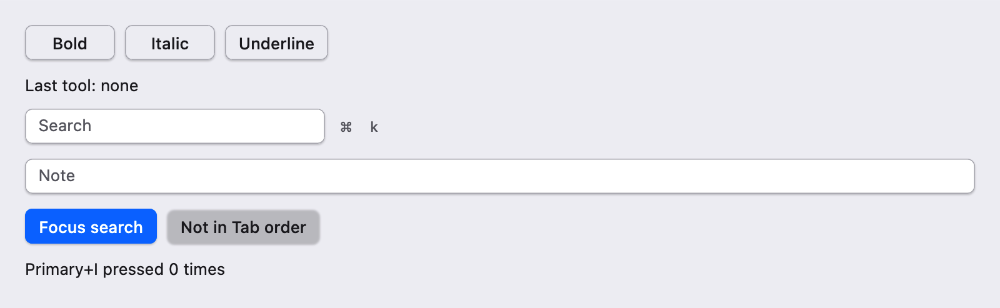
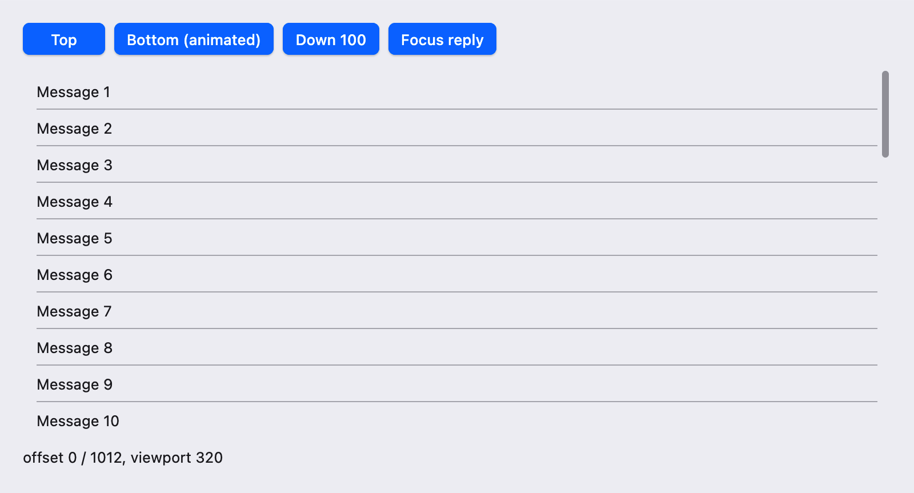
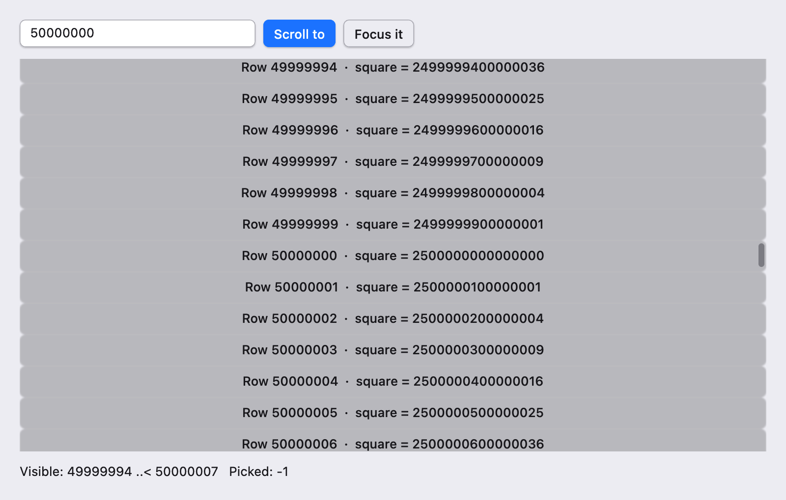

# 焦点、键盘与滚动

本篇是 UI 教程的第 9–10 章：先让界面能完全用键盘操作，再处理放不下的内容——从普通滚动区域到一亿行的虚拟列表。上一篇是[输入与表单]({{ '/ui-forms.html' | relative_url }})，下一篇是[弹层与导航]({{ '/ui-overlays.html' | relative_url }})。

示例沿用上一篇的约定：单文件程序、`scoop run <文件> --release` 运行（Windows 写 `sco`），在 `render` 开头取局部变量后再在 builder lambda 中使用，根视图用 `frame` 铺上主题背景。

## 9. 焦点与键盘

### 9.1 默认的 Tab 行为

标准控件默认都可以获得焦点并加入 Tab 顺序：按钮、输入框、勾选框、滑块、滚动区域等。不写任何代码时，Tab 按控件挂载的先后（大致就是代码中出现的顺序）前进，Shift+Tab 后退，到窗口末尾后回到开头。按钮在获得焦点时响应 Space 和 Enter；多行输入默认用 Tab 移动焦点，设置 `tab = TextTabBehavior.Insert` 后才会插入制表符。

用鼠标点击也会移动焦点，但只有键盘操作时才画出焦点环，这是平台惯例。

### 9.2 FocusOptions：句柄、Tab 停靠与顺序

每个标准控件都有 `focus` 配置，类型是 `FocusOptions(handle, tabStop, order)`，三个参数都可省略：

| 参数 | 默认值 | 作用 |
| --- | --- | --- |
| `handle` | `None` | 传入 `Some(FocusHandle())`，以便程序查询或请求焦点 |
| `tabStop` | `true` | `false` 时 Tab 跳过该控件，鼠标和程序聚焦仍然有效 |
| `order` | `0` | Tab 顺序按 `order` 从小到大排列，相同值保持挂载顺序 |

`order` 在整个焦点范围（默认是整个窗口）内排序，而不是只在父容器内。所以 `order = -1` 能让一个控件成为窗口中第一个 Tab 停靠点；反过来，给某个控件设置正数，它会排到所有默认控件之后。需要局部调整时，优先调整代码顺序，或用 9.4 节的焦点范围把一组控件圈起来。

### 9.3 程序聚焦：FocusHandle.requestFocus

`FocusHandle` 是对某个控件的稳定引用。把它放在组件字段中，通过 `FocusOptions(Some(handle))` 交给控件，之后就可以：

- `handle.requestFocus()`：请求聚焦，返回是否接受了请求；
- `handle.hasFocus`：查询当前是否拥有焦点；
- `handle.isPending`：请求是否还在等待兑现。

请求并不总是立刻生效。目标在滚动区域中被滚出可见范围时，框架会先把它滚动到可见位置再聚焦；目标还没有完成第一次布局时，请求会保留到该帧被系统接受（Accepted）之后再兑现。这段时间内 `isPending` 为 `true`。新的焦点请求会取消尚未兑现的旧请求，所以连续调用不会产生“焦点乱跳”。

焦点只能在事件回调中改变，例如按钮的点击回调、快捷键动作或 `onMount`；在 `render` 期间请求焦点会报错。

### 9.4 焦点范围与方向键导航

下面两项能力是 `ComponentScope` 提供的，每个组件在 `onMount` 中最多登记一次，并在组件卸载时自动释放：

- `scope.focusScope(FocusScopeOptions(loop = true))` 把当前组件的子树变成一个焦点范围：Tab 在组内循环，不会离开这一组。对话框之类的弹层通常需要这种行为。
- `scope.keyNavigation(...)` 把一组 `FocusHandle` 接入方向键和 Home／End。默认是 roving 模式：整组只占一个 Tab 停靠点，进入组之后用方向键在成员间移动。`layout` 可选 `Horizontal`、`Vertical` 或按行列定位的 `Grid`（用 `item(handle, row, column)` 登记）。它只移动焦点，激活仍由控件自己处理。

一个循环焦点范围的最小写法：

```scoop
class LoopGroup(scope: ComponentScope): Component(scope) {
    private val a = TextEditorState()
    private val b = TextEditorState()
    public override fun onMount() {
        // Tab and Shift+Tab cycle inside this component instead of leaving it.
        scope.focusScope(FocusScopeOptions(loop = true))
    }
    public override fun render(): View {
        val a = this.a
        val b = this.b
        return column {
            this.input(a)
            this.input(b)
        }
    }
}
```

把它作为子组件挂载：`this.add(component({ mount -> LoopGroup(mount) }))`。自绘控件如何登记焦点目标，见[自绘元素]({{ '/ui-custom.html' | relative_url }})。

### 9.5 快捷键

窗口内的快捷键用 `ShortcutScope`（来自 `scoop.surface`）登记。在组件的 `onMount` 中用 `scope.resource { ... }` 创建它，组件卸载时快捷键自动注销：

```scoop
scope.resource {
    ShortcutScope(
        scope.input,
        [shortcutBinding(primaryChord("i"), { count.value += 1 })]
    )
}
```

`ShortcutChord` 由按键和修饰键组成，`ShortcutModifiers(primary = true)` 表示“主修饰键”：macOS 上是 Cmd，Linux 和 Windows 上是 Ctrl，同一份代码在各平台都符合习惯。快捷键在控件的默认行为之后执行，因此输入框自己的 Cmd+C、Cmd+Z 等编辑操作不会被它截走。

多窗口应用如果需要一组与具体窗口无关的应用级快捷键，可以在创建窗口前用 `UiHost.shortcutScope(bindings)` 登记；窗口内的 `ShortcutScope` 优先于它。完整的 `UiHost` 用法见[桌面集成与异步]({{ '/ui-desktop.html' | relative_url }})。

要在界面上展示快捷键，用 `kbdGroup(chord)`：它直接使用与绑定相同的 `ShortcutChord`，按当前平台的标签分成几个键帽显示（例如 macOS 上的 ⌘ 和 K）。

### 9.6 完整示例

```scoop

```

运行：

```sh
scoop run ui-focus-scroll-keyboard.scoop --release
```

{: .screenshot width="800"}

操作一下：

- 窗口获得焦点后按 Tab，焦点首先落在 Search 输入框上，因为它的 `order` 是 `-1`。
- 继续按 Tab 进入工具栏，此时用左右方向键在 Bold、Italic、Underline 之间移动（到末尾会绕回开头）；再按 Tab 直接离开工具栏，而不是逐个经过三个按钮。
- “Not in Tab order” 按钮不会被 Tab 选中，但仍可以用鼠标点击。
- 点击 “Focus search”，或在任意位置按 Primary+K（macOS 上是 Cmd+K），焦点回到搜索框。
- 按 Primary+I，最后一行的计数加一。

## 10. 滚动与长列表

### 10.1 滚动区域

`scrollArea(content) { ... }` 在内容超出可用空间时提供滚动：鼠标滚轮、触控板、拖动滚动条、键盘（获得焦点后用方向键、Page Up／Down、Home／End）都可以操作。常用配置：

| 配置 | 作用 |
| --- | --- |
| `height` / `width` | 视口大小，例如 `Some(320.0)`；不设置时使用父级给出的空间 |
| `axes` | 滚动方向，默认 `ScrollAxes.Vertical` |
| `state` | 传入自己持有的 `ScrollState`，以便读取和控制滚动位置 |
| `scrollbars` | `ScrollbarVisibility.Auto`、`Always` 或 `Hidden` |

### 10.2 ScrollState：读取与控制位置

和 `TextEditorState` 一样，`ScrollState` 由调用方持有、交给控件借用。在 `render` 中读取它的属性，滚动时界面会自动刷新：

- `offset`：当前滚动位置；`maximum`：最大可滚动位置；`viewport` 和 `content`：视口和内容的大小。

控制位置的方法要在事件回调中调用：

- `scrollTo(Point(x, y))`：跳到指定位置；
- `scrollBy(Point(dx, dy))`：相对滚动，返回实际滚动的距离；
- `animateTo(Point(x, y))`：平滑滚动，默认 300 毫秒；
- `reveal(rect, horizontal, vertical)`：滚动到让内容坐标中的矩形可见，对齐方式为 `ScrollAlignment.Nearest`、`Start`、`Center` 或 `End`。

还有更简单的“滚动到某个控件”：对滚动区域内的控件调用 `FocusHandle.requestFocus()`，框架会先把它滚入视野再聚焦（9.3 节）。

```scoop

```

运行：

```sh
scoop run ui-focus-scroll-area.scoop --release
```

{: .screenshot width="800"}

窗口顶部有四个按钮，下面是一个 320 高的滚动区域，包含 40 条消息和底部的回复框，最下一行实时显示滚动位置。滚动时数字随之变化；Top 立即回到顶部；“Bottom (animated)” 平滑滚到底部；“Down 100” 每次向下 100；“Focus reply” 把回复框滚入视野并聚焦，可以直接输入。

### 10.3 虚拟列表：只构建看得见的行

`scrollArea` 会构建全部内容，适合几十到几百个子视图。数据更多时用 `virtualList(source, extent)`：它只为当前可见（加上少量预留）的行构建视图，滚动时复用，内存和布局开销与总行数无关。

数据通过实现 `ItemSource` 接口提供：

```scoop
class NumberRows(private val picked: State<Long>): ItemSource {
    public override val count: Long get() = 100000000L
    public override fun keyAt(index: Long): ViewKey = ViewKey.Number(index)
    public override fun indexOfKey(key: ViewKey): Long? =
        when (key) {
            case Number(index) -> if (index >= 0L && index < count)
                Some(index)
            else
                None
            else -> None
        }
    public override fun build(index: Long): View {
        val picked = this.picked
        return button(f"Row ${index}  ·  square = ${index * index}", { picked.value = index }) {
            this.variant = ButtonVariant.Ghost
        }
    }
}
```

这个数据源来自 10.6 节的示例。`count` 是总行数；`keyAt` 和 `indexOfKey` 在下标与稳定的 key 之间互相转换，滚动定位、聚焦和保留状态都靠 key 识别行，所以同一行的 key 不能随滚动变化；`build` 为一行创建视图——这里每行是一个按钮，点击时把行号写进状态 `picked`。

第二个参数 `ItemExtent` 说明行高：

- `ItemExtent.Fixed(32.0)`：每行同样高，定位最快，适合大部分列表；
- `ItemExtent.Variable(56.0)`：行高不同，参数是估计值，实际高度在行第一次布局后记录下来。

### 10.4 VirtualListHandle：定位、聚焦与阅读位置

虚拟列表的大部分行并不存在，所以不能用普通的 `FocusHandle` 或像素位置去找它们。改用 `VirtualListHandle`，通过 `handle = Some(list)` 交给列表：

- `scrollToItem(key, ScrollAlignment.Center)`：滚动到指定行，即使它离当前位置有几千万行；
- `focusItem(key)`：滚动到该行并聚焦行内第一个可聚焦控件；
- `reading`：当前的阅读快照（`VirtualReadingSnapshot?`），其中 `visible` 是可见行的下标范围，`atEnd` 表示是否已滚到末尾；在 `render` 中读取它，滚动时自动刷新。

设置 `navigation = ItemNavigation.Roving()` 后，整个列表只占一个 Tab 停靠点，进入后用上下方向键和 Home／End 在行之间移动——同样不需要预先构建所有行。

### 10.5 保留行状态与绘制缓存

默认情况下，滚出视野的行会被销毁（`ItemRetention.Dispose`），滚回来时重新构建。如果行内有自己的状态（比如一个子组件的动画或展开状态）需要保留，用 `retention = ItemRetention.KeepAlive(20L)` 让最多 20 个离屏行保持挂载。行内输入框的文字放在 `TextEditorState` 中、由数据源持有时，即使行被销毁也不会丢失：

```scoop
class Notes(private val editors: Array<TextEditorState>): ItemSource {
    public override val count: Long get() = editors.size
    public override fun keyAt(index: Long): ViewKey = ViewKey.Number(index)
    public override fun indexOfKey(key: ViewKey): Long? =
        when (key) {
            case Number(index) -> if (index >= 0L && index < count) Some(index) else None
            else -> None
        }
    public override fun build(index: Long): View = textarea(editors[index]) { this.rows = 2L }
}
```

```scoop
this.virtualList(notes, ItemExtent.Variable(56.0)) {
    this.height = Some(300.0)
    this.retention = ItemRetention.KeepAlive(20L)
    this.paintCache = PaintCachePolicy.Tiles()
}
```

`paintCache = PaintCachePolicy.Tiles()` 把已绘制的内容按图块缓存，滚动时只需重绘新露出的部分。内容绘制较重（大量文字或图形）时可以打开它；普通列表保持默认的 `None` 即可。`scrollArea` 也有同名配置。

### 10.6 演示：一亿行的列表

```scoop

```

运行：

```sh
scoop run ui-focus-scroll-virtual.scoop --release
```

{: .screenshot width="800"}

窗口启动和滚动都和普通列表一样快，尽管列表有一亿行：每一行的文字在 `build` 中即时计算，程序没有为任何一行预先分配数据。拖动滚动条可以快速到达任意位置；底部一行显示当前可见的行号范围和最后点击的行。在输入框中填入行号（默认 `50000000`）后点击 “Scroll to”，列表把该行滚动到中央；“Focus it” 则聚焦这一行的按钮，此时可以用上下方向键逐行移动，按 Space 点击当前行。

## 常见错误与继续阅读

| 现象 | 原因与解决 |
| --- | --- |
| 给控件设了 `order = 1`，它跑到了窗口最后 | `order` 在整个焦点范围内排序，所有默认控件都是 `0`。用负数提前，或调整代码顺序 |
| `requestFocus()` 之后 `hasFocus` 仍是 `false` | 目标需要先滚入视野或完成布局，请求处于 pending 状态，下一帧才兑现；用 `isPending` 查询 |
| 在 `render` 中调用 `requestFocus` 或 `scrollTo` 报错 | 焦点和滚动位置只能在事件回调或 `onMount` 中修改 |
| `mount already has a focus scope` / `key navigation` | 一个组件只能登记一次；需要多组时拆成多个子组件 |
| 快捷键没有反应 | `ShortcutScope` 没有用 `scope.resource` 保存，被提前释放；或窗口当前没有焦点 |
| `animateTo` 报 `smooth scrolling requires an attached viewport` | `ScrollState` 还没有交给任何已显示的滚动区域 |
| 虚拟列表滚动后行内状态丢失 | 默认 `ItemRetention.Dispose` 会销毁离屏行；把数据放进数据源，或使用 `KeepAlive` |
| `scrollToItem` 返回 `false` | 列表还没有挂载，或 key 不在数据源中（检查 `indexOfKey`） |

下一篇[弹层与导航]({{ '/ui-overlays.html' | relative_url }})介绍对话框、菜单和标签页，它们会用到本篇的焦点范围与焦点恢复。想自己实现可聚焦、可滚动的控件，请阅读[自绘元素]({{ '/ui-custom.html' | relative_url }})。
