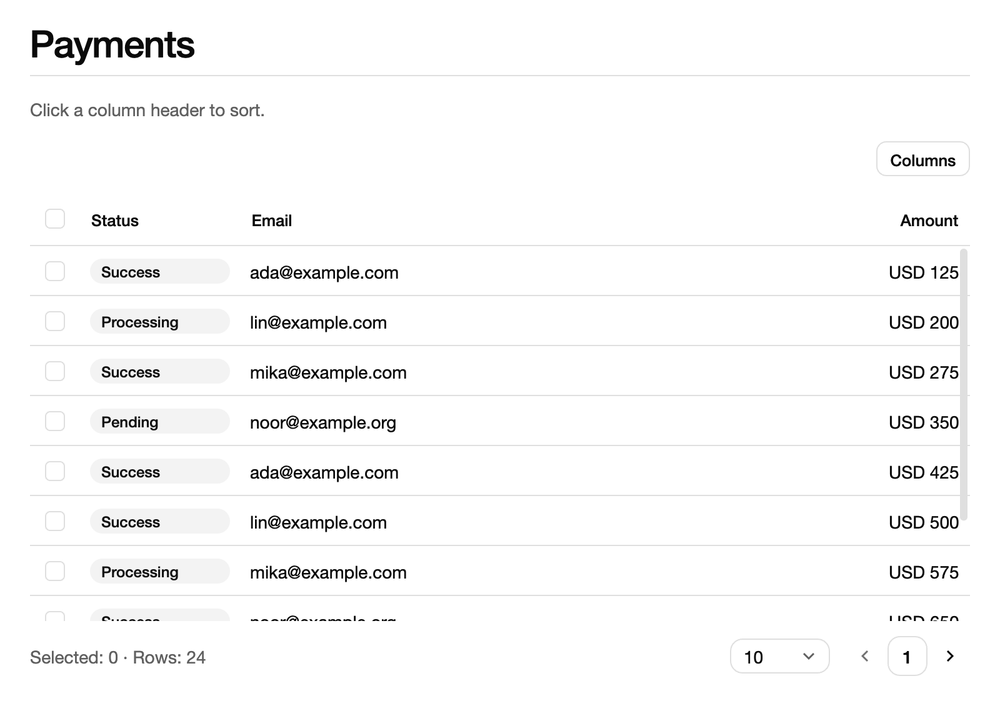
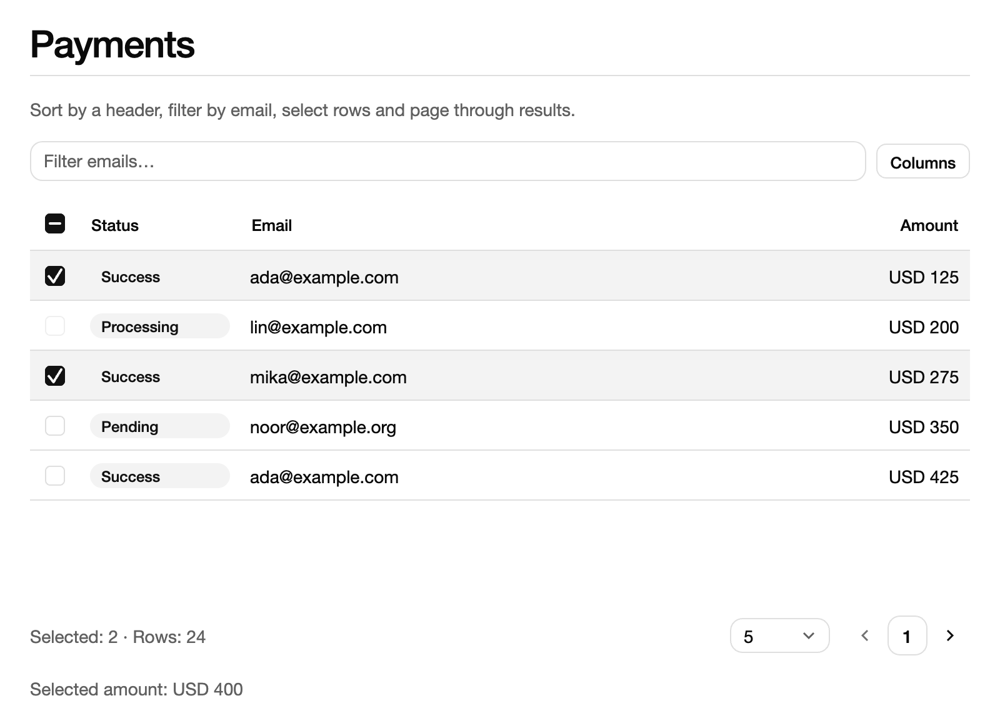
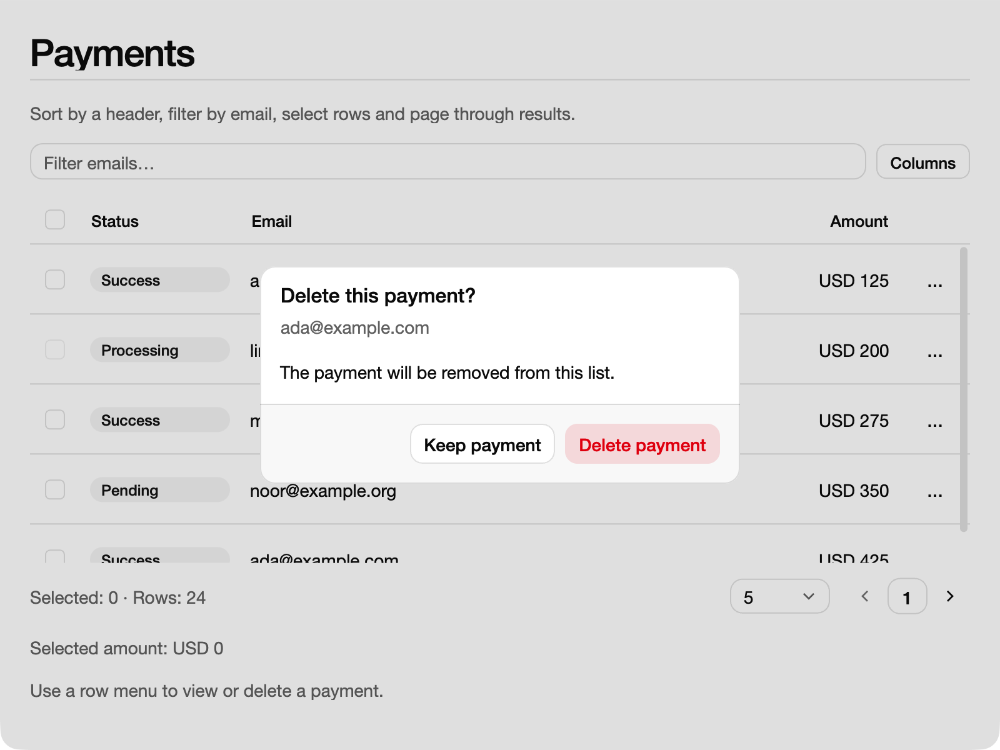
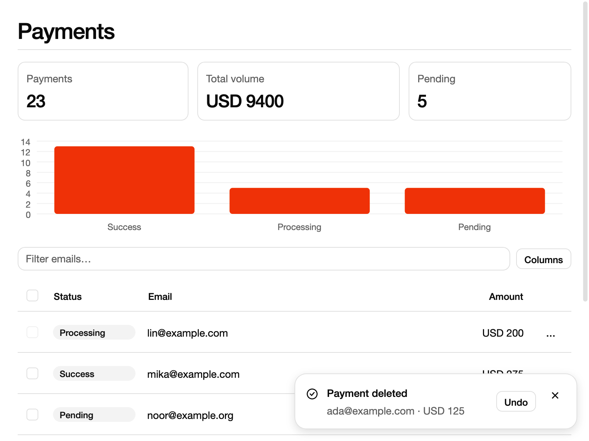

# UI 教程：综合项目

前面各篇分别介绍了布局、状态、表单、弹层、数据展示和主题。本篇把它们组合起来，从零写一个小型付款管理应用：一张可以排序、筛选、分页和选择的付款表格；每行有一个操作菜单，删除前弹出确认对话框；删除后在通知里提供“撤销”；页面顶部的统计卡片和柱状图随数据实时变化。

它是 shadcn 组件 Gallery 中 Data 页面的精简版。上一篇：[测试 UI]({{ '/ui-testing.html' | relative_url }})；全套目录见[总览]({{ '/ui.html' | relative_url }})。

本篇的示例都是单文件程序，用 `//! dep:` 声明依赖、用 `scoop run <文件> --release` 运行（Windows 写 `sco`）。程序分四步逐渐完善，每一步都是可以单独编译运行的完整程序，下一步只在上一步的基础上增加代码。示例在 macOS 上验证。

## 23. 综合项目：付款数据应用

### 23.1 先决定数据放在哪里

动手之前，先划分好各部分的职责。这个应用由四部分组成：

| 部分 | 类型 | 负责什么 |
| --- | --- | --- |
| 业务数据 | `Payment` | 一条付款记录：编号、邮箱、金额、状态 |
| 应用状态 | `PaymentStore` | 持有记录列表，以及依赖它的表格、图表、通知和对话框状态；提供删除、恢复等操作 |
| 根组件 | `PaymentsApp` | 只读取 Store，把它画成页面，并把用户操作转发给 Store |
| 行菜单 | `PaymentActions` | 只保存“这一行的菜单是否展开”这一项局部状态 |

这正是[状态与数据流]({{ '/ui-state.html' | relative_url }})一章的思路：**会被多个界面共享、需要比某个组件活得更久的数据，放在应用持有的 Store 中；组件只负责呈现，只保存纯粹属于自己的那一小块界面状态。**放在这个项目里，好处很具体：

- **数据只有一份。**表格、统计卡片和图表读的是同一份记录。删除或恢复时只需要在 Store 里改一次，不会出现表格已经删掉、图表还在显示旧数字的情况。
- **组件重建不丢数据。**表格滚出视野、对话框关闭、组件被重新挂载，记录和选择状态都还保存在 Store 中。
- **操作可以脱离窗口测试。**`confirmDelete`、`restore` 都是普通方法，可以按[测试 UI]({{ '/ui-testing.html' | relative_url }})的做法直接调用并断言，不必启动窗口。

控件库也按这个分工设计：`DataTableState`、`ChartModel`、`ToastState` 都由应用创建并持有，`dataTable(...)`、`chart(...)`、`toaster(...)` 只负责把它们画出来。

### 23.2 第一步：数据模型与表格

第一步定义付款记录，把它放进 `DataTableState`，再用 `dataTable` 显示出来。保存为 `ui-project-step1.scoop`（[下载](examples/ui-project-step1.scoop)）：

```scoop

```

运行：

```sh
scoop run ui-project-step1.scoop --release
```

{: .screenshot width="800"}

窗口显示标题“Payments”和一张 24 行的付款表格，每页 10 行，表体可以滚动。点击 Status、Email 或 Amount 表头，会按该列升序排序，表头出现 `↑` 标记；再点一次改为降序，第三次取消排序；每行开头的复选框可以选中行；右上角的 Columns 按钮可以隐藏或显示列；表格底部显示“Selected: 0 · Rows: 24”和分页控件。

这段代码有几处值得注意：

- **每一行都有稳定的 key。**`paymentRows` 用 `TableRecord(ViewKey.Number(records[at].id), records[at])` 包装每条记录。表格根据 key 识别行：排序、筛选或删除后，选中状态、行菜单等都跟着同一条记录走，而不是跟着显示位置走。所以 key 要用业务编号，不要用数组下标。
- **列是带类型的描述。**`TableColumn` 依次给出列 id、表头文字、单元格怎样显示（`(Payment) -> View`）和列宽。`compare` 提供比较函数后，这一列就可以排序；没有提供的列不能排序。列宽中 `GridTrack.Fraction(1.0)` 占满剩余宽度，`GridTrack.Fixed(120.0)` 固定宽度，`GridTrack.Auto` 配合 `samples` 按样例文字估算宽度。
- **表格状态属于 Store。**`DataTableState` 保存数据、排序、筛选、分页和选择结果。`main` 创建一个 `PaymentStore`，再交给根组件；组件不自己创建业务数据。
- **render 开头先取局部变量。**`val store = this.store` 之后，`column { ... }` 里的 lambda 才能使用 `store`。在 builder lambda 中，接收者是 builder 本身，Scoop 不允许隐式使用外层的组件成员，写 `this.store` 或直接写 `store` 都会出错，见[布局与文字]({{ '/ui-layout.html' | relative_url }})。
- **根 frame 负责铺背景。**组件字段 `currentThemeSource()` 取得 `main` 中绑定的主题来源，render 从 `this.theme.current.value` 读取当前主题的页面背景色，再通过 `frame` 的 `style` 铺满窗口。不铺背景时，窗口在 macOS 上是黑底，浅色主题的深色文字就看不见了。`alignment = Alignment(AxisAlignment.Start, AxisAlignment.Start)` 让内容从左上角开始排，而不是默认居中。

### 23.3 第二步：筛选、分页和选择

第二步在表格上方加一个邮箱筛选框，改为每页 5 行，限制哪些行可以选中，并在表格下方显示选中付款的合计金额。保存为 `ui-project-step2.scoop`（[下载完整源码](examples/ui-project-step2.scoop)）。下面只列出新增和改动的部分。

筛选需要一个大小写不敏感的比较。文件开头新增一项依赖，并在原有 import 之间按字母顺序插入三行 import：

```scoop
//! dep: scoop:scoop.charset:0.1.0
```

```scoop
import scoop.charset.unicodeCasefold
```

```scoop
import scoop.text.contains
```

```scoop
import scoop.ui.text.TextEditorState
```

Email 列增加 `filter`。它接收一行数据和当前筛选文字，返回这一行是否保留：

```scoop
            compare = Some { a, b -> a.email.compareTo(b.email).toInt() },
            filter =
                Some { row, text -> unicodeCasefold(row.email).contains(unicodeCasefold(text)) }
```

`unicodeCasefold` 按 Unicode 规则折叠大小写，比只处理 ASCII 字母的转换更稳妥。

Store 新增筛选框的编辑状态、初始页大小、筛选操作和一个派生值：

```scoop
    val filter = TextEditorState()
    val table =
        DataTableState(
            TableData.Local(paymentRows(records)),
            paymentColumns(),
            selectable = { row -> row.status != "Processing" }
        )
    init {
        table.setPageSize(5L)
    }

    fun applyFilter() {
        table.setFilter("email", filter.committedText)
    }
    // Derived from the table's selection; nothing is copied into a second list.
    val selectedAmount: Int get() {
        var total = 0
        for (record in records)
            if (table.isSelected(ViewKey.Number(record.id)))
                total += record.amount
        return total
    }
```

- `TextEditorState` 保存输入框的文字、光标和撤销历史。它也放在 Store 里，筛选文字就不会因为组件重建而丢失。
- `setFilter("email", text)` 用列 id 指定要筛选哪一列。Local 数据的筛选、排序和分页都由 `DataTableState` 计算，结果会被缓存，界面只读取当前页。
- `selectable` 决定哪些行可以选中。这里“Processing”的付款不能选，它们的复选框显示为禁用。
- `selectedAmount` 每次读取时，根据表格当前的选择状态重新计算，而不是另外维护一份“已选列表”。选择状态只有一份，就不会出现两份数据不一致的问题。

render 中新增筛选框，并配置表格：

```scoop
        val filterInput =
            input(store.filter) {
                this.placeholder = "Filter emails…"
                this.onEdited = { _ -> store.applyFilter() }
            }
```

```scoop
            this.dataTable(store.table) {
                this.bodyHeight = 280.0
                this.pageSizes = [5L, 10L, 20L]
                this.toolbar(filterInput)
            }
            this.typography(f"Selected amount: USD ${store.selectedAmount}", TypographyRole.Muted)
```

筛选框在 `column { ... }` 之前创建，再通过 `toolbar` 放到表格工具栏中。不能在 `column` 的 lambda 里直接写 `input(...)` 或 `label(...)`：那里的同名调用会解析成 builder 的成员方法，作用是“把一个子项加入 column”，返回 `Unit` 而不是 `View`。`pageSizes` 是页大小下拉框的选项。

运行后，在筛选框中输入 `ada`，表格只剩 6 条 ada@example.com 的付款，底部显示“Rows: 6”。选中几行，下方的“Selected amount”随之变化；切换页码时，其他页上的选择仍然保留。

{: .screenshot width="800"}

### 23.4 第三步：行菜单与删除确认

第三步给每行加一个 `…` 菜单，提供“View details”和“Delete payment”两项；删除前弹出确认对话框。保存为 `ui-project-step3.scoop`（[下载完整源码](examples/ui-project-step3.scoop)）。

先给 `paymentColumns` 增加两个回调参数，并增加一个操作列：

```scoop
fun paymentColumns(onDetails: (Payment) -> Unit, onDelete: (Payment) -> Unit): Array<
    TableColumn<Payment>
> =
```

```scoop
        TableColumn(
            "actions",
            "",
            { row -> component({ scope -> PaymentActions(row, onDetails, onDelete, scope) }) },
            TableColumnSize(GridTrack.Fixed(56.0), minimum = 48.0),
            hideable = false,
            resizable = false
        )
```

单元格不一定只能放文字。`component({ scope -> ... })` 在单元格里挂载一个组件，它和其他组件一样有自己的状态和生命周期。操作列不需要隐藏或调整宽度，因此关闭了 `hideable` 和 `resizable`。

行菜单组件只保存“菜单是否展开”：

```scoop
// Each row's menu keeps its own open state; the actions go back to the store.
class PaymentActions(
    private val row: Payment,
    private val onDetails: (Payment) -> Unit,
    private val onDelete: (Payment) -> Unit,
    scope: ComponentScope
): Component(scope) {
    private val open = state(false)
    public override fun render(): View {
        val row = this.row
        val onDetails = this.onDetails
        val onDelete = this.onDelete
        return dropdownMenu(
            open.binding(),
            menu {
                this.label(ViewKey.Text("title"), f"Payment ${row.id + 1L}")
                this.item(ViewKey.Text("details"), "View details", { onDetails(row) })
                this.separator(ViewKey.Text("separator"))
                this.item(ViewKey.Text("delete"), "Delete payment", { onDelete(row) }) {
                    this.destructive = true
                }
            }
        ) {
            this.trigger("…") {
                this.variant = ButtonVariant.Ghost
                this.size = ButtonSize.IconSm
            }
        }
    }
}
```

“菜单是否展开”只和这一行有关，所以放在组件自己的 `state` 中；“删除哪条记录”涉及整个应用，所以通过回调交给 Store。菜单每一项都有显式 key，`destructive = true` 把删除项显示为警示色。

Store 新增三项状态和三个操作：

```scoop
    val status = state("Use a row menu to view or delete a payment.")
    val confirming = state(false)
    val pending = state<Payment?>(None)
```

```scoop
            paymentColumns({ row -> showDetails(row) }, { row -> askDelete(row) }),
```

```scoop
    fun showDetails(row: Payment) {
        status.value = f"Payment ${row.id + 1L}: ${row.email}, USD ${row.amount}, ${row.status}."
    }
    fun askDelete(row: Payment) {
        pending.value = Some(row)
        confirming.value = true
    }
    // The alert dialog does not close itself on the action; the store decides.
    fun confirmDelete() {
        val row = pending.value ?: return
        confirming.value = false
        pending.value = None
        val next = ArrayList<Payment>()
        for (record in records)
            if (record.id != row.id)
                next.add(record)
        records = next.toArray()
        table.replaceData(TableData.Local(paymentRows(records)))
        status.value = f"Payment ${row.id + 1L} deleted."
    }
```

删除分成两步：`askDelete` 只记下待删除的记录并打开对话框；用户确认后，`confirmDelete` 才真正修改数据。修改记录后要调用 `table.replaceData`，把新数据交给表格。表格保留当前的排序、筛选和页码，并自动去掉已不存在的行的选择。

最后在 render 中加入状态文字和确认对话框：

```scoop
        val warning = label("The payment will be removed from this list.")
```

```scoop
            this.typography(store.status.value, TypographyRole.Muted)
            this.alertDialog(store.confirming.binding(), warning) {
                this.title("Delete this payment?")
                this.description(store.pending.value?.email ?: "")
                this.cancel("Keep payment")
                this.action("Delete payment", { store.confirmDelete() }) {
                    this.variant = ButtonVariant.Destructive
                }
            }
```

`alertDialog` 的打开状态绑定到 Store 的 `confirming`。点击 cancel 按钮会通过这个绑定关闭对话框；**action 按钮不会自动关闭对话框**，由 `confirmDelete` 把 `confirming` 设回 `false`。这样设计是为了让应用自己决定什么时候关闭，例如提交失败时可以让对话框保持打开。对话框打开时，焦点默认落在 cancel 按钮上，误按 Enter 不会删除数据。

运行后点击某一行的 `…`，菜单显示“Payment N”、“View details”和红色的“Delete payment”。选择 Delete payment 后，页面变暗，弹出“Delete this payment?”对话框并显示该行的邮箱；点击“Keep payment”关闭对话框，数据不变；点击“Delete payment”后对话框关闭，底部的行数减 1，状态文字变为“Payment N deleted.”。

{: .screenshot width="800"}

### 23.5 第四步：撤销与汇总联动

最后一步完成整个应用：删除后弹出带“Undo”按钮的通知，点击后把记录恢复到原来的位置；表格上方增加三张统计卡片和一张按状态统计的柱状图，它们随删除和恢复同步更新。保存为 `ui-project-step4.scoop`（[下载](examples/ui-project-step4.scoop)）：

```scoop

```

运行：

```sh
scoop run ui-project-step4.scoop --release
```

{: .screenshot width="800"}

窗口顶部显示三张卡片：Payments 24、Total volume USD 9525、Pending 5；下面是柱状图，Success 14、Processing 5、Pending 5。删除一条 Success 状态、金额 425 的付款后，卡片变为 23 和 USD 9100，Success 柱降到 13；窗口右下角滑出“Payment deleted”通知，显示邮箱和金额，旁边有“Undo”按钮。5 秒内点击 Undo，通知关闭，记录回到表格中原来的位置，卡片和图表恢复原值。页面比默认窗口高，可以用滚轮滚动查看表格和底部的状态文字。

这一步相对第三步有以下改动。

**记录列表改为 State。**

```scoop
    val records = state(Array<Payment>(24L) { at -> samplePayment(at) })
```

第三步中 `records` 只在 Store 内部使用，每次修改后会调用 `replaceData`，表格因此刷新。现在 render 还要直接读取 `store.summary`，而它由 `records` 计算得出。只有读取的是 State，组件才会在它变化后重新渲染；普通 `var` 变了，界面不会知道。

**派生数据集中在一个地方更新。**

```scoop
    // One place pushes a new record list to every view that depends on it.
    private fun replaceRecords(next: Array<Payment>) {
        records.value = next
        table.replaceData(TableData.Local(paymentRows(next)))
        chart.replaceData(statusChart(next))
    }
```

删除和恢复都只调用 `replaceRecords`。以后再加一个依赖记录的视图，也只需要改这一处。统计卡片不用单独存储，`summary` 每次从 `records.value` 重新计算；图表的 `ChartModel` 还保存了“隐藏了哪些系列”等界面状态，所以用 `replaceData` 替换数据，而不是每次新建一个模型。

**删除时记住原位置，并显示通知。**`confirmDelete` 在过滤记录的同时记下被删记录的下标，然后调用 `notifications.show`：

```scoop
        val store = this
        val originalPosition = position
        notifications.show("Payment deleted") {
            this.kind = ToastKind.Success
            this.description(f"${row.email} · USD ${row.amount}")
            this.action("Undo", { store.restore(row, originalPosition) })
        }
```

`show` 后面的 lambda 是通知的配置块，里面的 `this` 是通知 builder，所以先把 Store 存进局部变量 `store`。通知默认显示 5 秒，action 按钮点击后会自动关闭通知。

**恢复操作可以重复调用。**`restore` 先检查记录是否已经存在，存在就直接返回；否则把同一个 `Payment` 对象插回原下标（如果期间又删了别的记录，原下标超出范围，就放到末尾）。恢复的是原来的对象，编号不变，表格 key 也就不变。

**通知与对话框放在同一棵树中。**

```scoop
            this.toaster(store.notifications)
```

`toaster` 是 `ToastState` 的显示位置，同一个 `ToastState` 只能绑定一个活动的 toaster。和 `alertDialog` 一样，它写在 `column` 里，但通知卡片显示在窗口的弹出层中，位置相对窗口（默认右下角），而不是跟着 column 中的位置。

**页面可以滚动。**卡片、图表和表格加在一起比默认的 800×600 窗口高。第二、三步中，内容超出窗口时，表格正文会被压缩，只能显示四行多一点。这里把整个 column 放进 `scrollArea`，并把内边距移到 column 上：

```scoop
        // The page is taller than the default window, so the root scrolls.
        return frame(scrollArea(content)) {
            this.style { this.background(Some(Paint(pageColor))) }
        }
```

需要固定窗口大小时，可以改用[桌面集成]({{ '/ui-desktop.html' | relative_url }})中的 `UiHost` 和 `windowAttributes { size = ... }` 创建窗口。

### 23.6 回顾：用到了哪些知识

| 本项目中的做法 | 对应章节 |
| --- | --- |
| `column`／`row`／`frame`、`item { grow = 1.0 }`、背景与对齐 | [布局与文字]({{ '/ui-layout.html' | relative_url }}) |
| Store 持有业务数据，组件只呈现；`state`、`binding()`、派生值 | [状态与数据流]({{ '/ui-state.html' | relative_url }}) |
| `TextEditorState` 与 `input`、`onEdited` | [输入与表单]({{ '/ui-forms.html' | relative_url }}) |
| 对话框默认聚焦 cancel、`scrollArea` 与虚拟化的表格正文 | [焦点与滚动]({{ '/ui-focus-scroll.html' | relative_url }}) |
| `dropdownMenu`、`alertDialog`、`ToastState`／`toaster` | [弹层与导航]({{ '/ui-overlays.html' | relative_url }}) |
| `DataTableState`／`dataTable`、`card`、`ChartModel`／`chart` | [数据展示]({{ '/ui-data.html' | relative_url }}) |
| `ThemeSource(shadcnTheme())`、`currentThemeSource()`、按钮 variant | [主题与样式]({{ '/ui-themes.html' | relative_url }}) |
| 窗口大小与应用根 | [桌面与异步]({{ '/ui-desktop.html' | relative_url }}) |
| 不启动窗口测试 `confirmDelete`／`restore` | [测试 UI]({{ '/ui-testing.html' | relative_url }}) |

### 23.7 继续扩展

这个应用的结构可以继续扩展。下面几个方向都只需要在现有结构上增加代码：

- **行内编辑。**给 `Payment` 增加一个 `val note = TextEditorState("")`，再增加一列，单元格写成 `{ row -> input(row.note) { ... } }`。编辑状态保存在记录对象里，所以排序、翻页、删除后撤销，备注都会保留。官方 Gallery 的 Data 页面就是这样做的。
- **明暗切换。**`ThemeSource.current` 是一个 State。加一个按钮，执行 `source.current.value = shadcnTheme(ThemeMode.Dark)` 即可切换到深色主题，控件和背景色会按新主题重绘，表格的数据和选择不受影响。
- **从右到左布局。**用 `direction(content, LayoutDirection.Rtl)` 包住页面，起止方向随之镜像：Start 对齐变成靠右，菜单等弹层也按 RTL 规则定位。可以用它检查布局里有没有写死“左”和“右”。
- **删除后的焦点去向。**用 `FocusHandle` 和 `FocusOptions` 指定焦点位置，例如对话框关闭后把焦点移到通知的 Undo 按钮上，让只用键盘的用户也能撤销。
- **服务端分页。**数据量很大时，把 `TableData.Local` 换成 `TableData.Provided(rows, totalRows)`，并在 `onQueryChange` 中按 `TableQuery` 请求对应的页；后台加载的写法见[桌面与异步]({{ '/ui-desktop.html' | relative_url }})。
- **为 Store 写测试。**删除、撤销、重复撤销、删除后再删除别的记录等情况，都可以直接调用 Store 的方法来测试。

### 23.8 常见错误与继续阅读

| 现象 | 原因与改法 |
| --- | --- |
| 编译报 `dependency function argument must be of type View, found Unit` | 在 `column { ... }` 里直接调用了 `label(...)`、`input(...)` 等，解析成了 builder 的成员方法。先在 builder 外用局部变量创建 View，再传进去 |
| 编译报 implicit use of an outer receiver is not allowed | 在 builder lambda 中直接使用了组件成员。在 render 开头写 `val store = this.store` |
| 编译报 `unknown function Insets` | 缺少 `import scoop.ui.style.Insets`。全部内边距相同时用 `Insets.all(24.0)` |
| 窗口是黑底，文字看不清 | 根 View 没有铺背景。用 `frame(...) { style { background(...) } }` 铺上主题背景色 |
| 点击对话框的 action 后对话框不关闭 | AlertDialog 的 action 不负责关闭，在操作中把绑定的 State 设为 `false` |
| 删除或排序后，选中状态跑到了别的行 | 行 key 用了数组下标。改用业务编号 `ViewKey.Number(id)` |
| 表格已更新，统计卡片或图表还是旧数据 | 只调用了 `table.replaceData`，或 render 读取的是普通 `var`。把记录放进 State，并在一个函数里更新所有依赖它的视图 |
| 撤销后同一条记录出现两次 | `restore` 没有检查记录是否已经存在。先检查编号再插入 |
| 表格只显示四行多，下面被截断 | 页面内容超过窗口高度，表格正文被压缩。把页面放进 `scrollArea`，或创建更大的窗口 |

要查看本篇用到的控件的完整用法，可以阅读工具链附带的 `scoop.ui.component` README，以及 shadcn Gallery 示例中的 `app_data.scoop`、`app_data_model.scoop` 和 `table_model.scoop`，它们是本篇示例的完整版本。要继续了解单个控件，回到[数据展示]({{ '/ui-data.html' | relative_url }})和[弹层与导航]({{ '/ui-overlays.html' | relative_url }})；全套目录见[总览]({{ '/ui.html' | relative_url }})。
