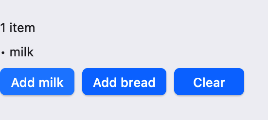

# UI 教程：测试 UI

本篇是 UI 教程的第 22 章：介绍如何用 `scoop test` 和 `scoop.test` 库测试 UI 程序。先测试不需要窗口的状态和业务逻辑，再在隐藏的原生窗口中测试组件，最后说明需要真实绘制的测试有哪些条件。上一篇：[桌面集成与异步]({{ '/ui-desktop.html' | relative_url }})；下一篇：[综合项目]({{ '/ui-project.html' | relative_url }})。

## 22. 测试 UI

### 22.1 先把逻辑放进业务类

UI 测试最省事的做法，是让大部分逻辑根本不需要窗口。`state(initial)` 创建的 State 是普通对象，可以放在任何类中，在测试里直接创建、读写和断言（见[状态与数据流]({{ '/ui-state.html' | relative_url }})）。因此建议这样组织代码：

- 业务规则（校验、增删、派生文字）写在普通类中，State 也放在这里；
- 组件的 render 只读取这些 State 并组合控件，回调只调用业务类的方法。

这样，绝大多数行为都可以用几毫秒的纯状态测试覆盖；只有“组件能否正确挂载、是否随状态更新”这类问题才需要原生窗口。

### 22.2 一个可测试的 Cone

测试库 `scoop.test` 要写进 `Cone.toml` 的 `[test-dependencies]`，测试代码放在 `tests/` 目录中，所以这里使用一个 Cone 项目，而不是单文件程序。本章的例子是一个购物清单程序，目录结构如下（[Cone.toml](examples/ui-testing-cone/Cone.toml)）：

```text
ui-testing-cone/
├── Cone.toml
├── src/
│   ├── main.scoop
│   └── shopping.scoop
└── tests/
    ├── list.scoop
    └── window.scoop
```

`Cone.toml` 把正式代码的依赖放在 `[dependencies]` 中，只供测试使用的库放在 `[test-dependencies]` 中，它们不会进入正式构建的程序：

```toml

```

源码的 `package` 必须是 Cone 的 group 或它的子包，这里 group 为 `guide.examples`，所以使用 `package guide.examples.shopping`。测试文件使用同一个包，可以直接访问 `src` 中的声明。

`src/shopping.scoop` 包含业务类 `ShoppingList` 和组件 `ShoppingView`（[下载](examples/ui-testing-cone/src/shopping.scoop)）：

```scoop

```

`ShoppingList` 中的规则：去掉首尾空白，拒绝空项和重复项，最多 5 项；`summary` 是由 `items` 派生的文字。`ShoppingView` 只负责显示和转发点击。`src/main.scoop` 是普通入口（[下载](examples/ui-testing-cone/src/main.scoop)）：

```scoop

```

在 Cone 目录的上一级运行 `scoop run ui-testing-cone --release`，可以看到这个窗口：顶部是 `Nothing to buy`，下面三个按钮；点 Add milk 后出现 `• milk`，摘要变为 `1 item`。

{: .screenshot width="275"}

### 22.3 纯状态测试

`tests/list.scoop` 直接测试 `ShoppingList`，不创建任何窗口（[下载](examples/ui-testing-cone/tests/list.scoop)）：

```scoop

```

运行测试：

```sh
scoop test ui-testing-cone --release
```

`scoop test` 构建并运行 `tests/` 中的测试，参数是 Cone 目录（省略时使用当前目录的 `Cone.toml`）。输出中这组测试为：

```text
ui-testing
  guide.examples.shopping.ShoppingListTests [passed]
    adding trims text and updates the summary (tests/list.scoop:9:5) passed (19000 ns)
    empty and duplicate items are rejected (tests/list.scoop:17:5) passed (2000 ns)
    the list stops at its limit (tests/list.scoop:25:5) passed (3000 ns)
    a binding writes through to the same state (tests/list.scoop:35:5) passed (1000 ns)
```

（下一节的窗口测试也会一起运行；耗时因机器而异。）`scoop.test` 的用法：

- 用 `@Test` 同时标注测试类和其中的测试方法。方法名可以用反引号写成一句话，失败报告中会原样显示。
- **每个测试方法使用一个新的类实例**，所以字段 `private val list = ShoppingList()` 在每个测试开始时都是空的，测试之间互不影响。需要公共准备和收尾时，分别用 `@BeforeTest`、`@AfterTest` 标注方法；收尾在测试失败时也会执行。
- 断言函数有 `assertEquals(expected, actual)`、`assertNotEquals`、`assertTrue`、`assertFalse`、`assertSame`（同一个引用）、`assertFailsWith<E> { ... }`（代码块应抛出 E 类型的异常），以及直接失败的 `fail(Some("message"))`。
- `@Ignore("reason")` 标注的测试默认跳过，用 `--ignored` 只运行它们。`--filter <text>` 只运行完整名称（含类名）包含该文字的测试，`--list` 只列出测试而不运行，`--no-run` 只构建不运行。

最后一个测试说明 Binding 不保存副本：通过 `list.items.binding()` 写入，读到的仍是同一个 State。控件的 Binding 参数也可以这样在测试中替代用户操作。

### 22.4 在隐藏窗口中测试组件

纯状态测试不能回答这些问题：组件能否正常挂载？render 是否真的读取了正确的 State，从而在数据变化后更新？窗口关闭时组件是否卸载？这需要真实的 `Application` 和 `UiHost`，但窗口不必显示出来。

`tests/window.scoop` 中只有一个测试（[下载](examples/ui-testing-cone/tests/window.scoop)）：

```scoop

```

这个测试的思路：

**一个进程只能有一个 Application。** 同一个 Cone 的测试运行在同一个进程中，而 `Application` 每个进程只能创建和运行一次。所以把需要原生窗口的检查集中在一个测试里；确实需要多次启动应用时，把它们放进不同的测试 Cone。

**隐藏窗口照样更新。** 窗口用 `visible = false` 创建。隐藏的窗口不绘制，但挂载、render、State 更新和卸载照常进行，不需要等待任何帧，所以这部分测试既快又不依赖桌面环境的可见状态。

**用探针组件记录 render 的结果。** View 是不透明的描述，测试不能直接读取“界面上显示了什么”。`SummaryProbe` 是只在测试中使用的根组件：它在 render 中读取 `probe.list.summary`，把读到的值和 render 次数记在普通字段中，再把真正的 `ShoppingView` 作为子组件渲染出来。真实组件因此也完整地挂载和更新了一遍。

**每一步是一次独立的投递。** 测试在 `Resumed` 中挂载窗口后，用 `active.proxy().post { ... }` 安排第一步。修改 State 后，框架会安排一次更新；随后投递的下一步排在这次更新之后执行，所以在下一步中就能断言 render 已经发生：第 0 步确认初次挂载 render 了一次、显示 `Nothing to buy`；它调用 `list.add("milk")` 后，第 1 步确认 render 次数变为 2、显示 `1 item`，而且始终没有绘制过任何帧。

**不要让测试挂起。** 如果某一步因为程序错误永远不会到来，事件循环会一直等待。`created.createDeadline { ... }.schedule(...)` 登记了一个 10 秒的截止时间，到期时 `fail(...)` 让测试失败。回调中的断言失败会结束事件循环，测试报告会指出失败的断言及其所在行，例如：

```text
    a hidden window follows shared state and a shown window presents a frame (tests/window.scoop:17:5) failed (136450000 ns)
      body at guide.examples:ui-testing:0.1.0/tests/window.scoop:83:17
      assertEquals: assertion failed
      expected: 2 items
      actual: 1 item
```

**结束后检查清理。** 最后一步调用 `requestExit()`。`Application.run` 返回后，`UiHost.use` 关闭宿主，所有组件卸载。测试在 `run` 返回后断言 `unmounts == 1`，确认 `onUnmount` 恰好执行了一次。

### 22.5 等待真实的帧

有时需要确认窗口真的画出来了，例如检查第一帧是否成功提交。示例的第 1 步之后调用 `window.setVisible(true)` 和 `requestFocus()` 显示窗口，然后等待第一帧：

- `FrameProbe` 是一个透传的自绘元素（写法见[自绘元素]({{ '/ui-custom.html' | relative_url }})），它原样测量、放置唯一的子项；
- 它在 `scene` 中用 `context.onFrameComplete { frame -> ... }` 登记本帧完成后的一次性通知；`frame.submission` 为 `Accepted` 表示这一帧已被系统接受；
- 收到第一个 Accepted 帧后，测试进入第 3 步并退出应用。

这类测试有几个限制，使用前要了解：

- **需要真实的桌面会话。** 被遮挡、未显示的窗口，以及锁屏或没有显示器的会话，系统可能不为窗口安排绘制，测试就会等到截止时间后失败。示例在显示窗口后请求焦点，使它出现在最前面。在没有桌面的持续集成环境中，可以给这类测试加上 `@Ignore("needs a desktop session")`，在有桌面的机器上用 `--ignored` 单独运行。
- **读回像素不在公开接口中。** 工具链自身的测试会读取窗口像素、模拟点击和输入法，它们使用的是工具链源码树中的内部测试辅助库（例如 `scoop.tests:surface-native`），这些库不随正式库发布，也不保证接口稳定，不建议应用依赖。应用一般用纯状态测试覆盖逻辑，用上面的隐藏窗口测试覆盖组件的挂载与更新，最终的视觉效果靠人工检查或截图。
- **没有公开的输入模拟。** 测试不能替用户“点击按钮”。这正是 22.1 节建议让回调保持简单的原因：回调只调用业务方法，测试直接调用同一个方法即可。

### 22.6 在 Linux 和 Windows 上运行窗口测试

**Linux**（GNU，x86_64）的 Wayland 和 X11 后端都使用 GTK 4 与 libadwaita，测试需要一个有效的显示会话。用环境变量 `SCOOP_WINDOW_BACKEND` 选择后端：

```sh
SCOOP_WINDOW_BACKEND=wayland scoop test ui-testing-cone --release
SCOOP_WINDOW_BACKEND=x11 scoop test ui-testing-cone --release
```

不设置时，存在 `WAYLAND_DISPLAY` 就使用 Wayland，否则使用 X11。所选的显示服务器连接失败时直接报错，不会自动改用另一个。`DISPLAY`、`WAYLAND_DISPLAY` 和 `XDG_RUNTIME_DIR` 按显示系统的常规约定设置。两个后端的行为有少量差异（例如 Wayland 不提供窗口的全局位置），涉及这些能力的测试应在两个后端上各运行一次。

**Windows** 上，通过 SSH 等非交互会话运行时无法创建原生 `Application`。在这种环境中用 `sco test ui-testing-cone --release --no-run` 只检查测试能否构建，在登录的桌面会话中再实际运行；也可以把窗口测试标注为 `@Ignore`，在桌面上用 `--ignored` 运行。

## 常见错误与继续阅读

| 现象 | 原因与处理 |
| --- | --- |
| 报 `package … must equal Cone group …` | 源码和测试的 `package` 必须是 Cone group 或其子包 |
| `import scoop.test.*` 找不到 | `scoop:scoop.test` 没有写进 `[test-dependencies]` |
| 第二个窗口测试报 `one Application per process` | 同一测试进程只能创建一个 Application；合并成一个测试，或拆到另一个测试 Cone |
| 窗口测试一直不结束 | 某一步没有被安排或条件永远不满足；用 `createDeadline` 设置截止时间 |
| 修改 State 后立即断言，render 次数没变 | 更新是异步安排的；在下一次 `proxy.post` 的步骤中再断言 |
| 等待帧的测试偶尔超时 | 窗口被遮挡、未聚焦或会话锁屏；在可见的桌面上运行，或标注 `@Ignore` 单独运行 |
| 测试之间互相影响 | 不要在顶层对象中保存可变状态；每个测试方法都会得到新的类实例，状态放在字段中 |

下一篇[综合项目]({{ '/ui-project.html' | relative_url }})把前面各篇的内容组合成一个完整的应用。`scoop.test` 的更多示例见工具链附带的 `~/.scoop/src/scoop.test/examples`。
