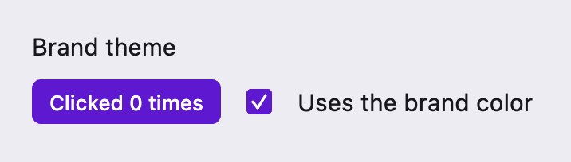
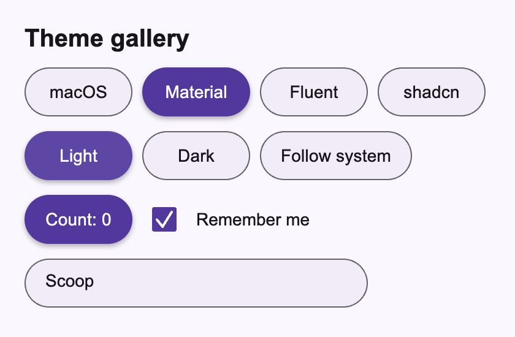
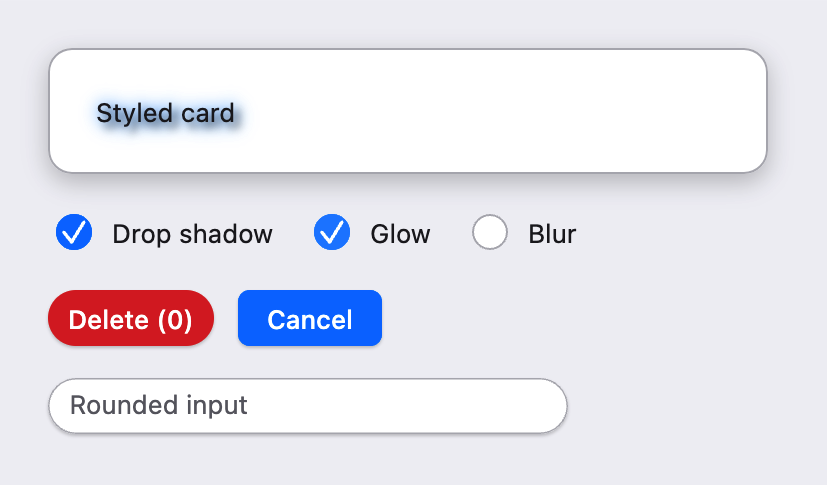

# UI 教程：主题与样式

本篇是 UI 教程的第 14–15 章。第 14 章讲整个应用的“主题”：选择预设、修改配色和字号、在运行时切换风格与明暗、跟随系统；第 15 章讲“局部样式”：给某一块内容加背景、边框、阴影和效果，以及为某个按钮、复选框、输入框单独设定外观。

上一篇：[数据展示]({{ '/ui-data.html' | relative_url }})。下一篇：[自绘元素]({{ '/ui-custom.html' | relative_url }})。

先记住一个分工：**主题（Theme）** 是整套设计数据——配色、字体、圆角、动效，以及表面、复选框、单选框、滚动条等部件的尺寸与各状态颜色；控件在绘制时向主题查询这些数据。**样式（Style）** 是一块内容自己的装饰——背景、边框、圆角、阴影和内容效果，只影响你包起来的那一部分。改主题会影响全部控件，改样式只影响局部。

## 14. 主题定制

### 14.1 四套预设

主题预设分别放在四个独立的 Cone 中，按需依赖其中一个或几个：

| Cone | 导入 | 风格 |
| --- | --- | --- |
| `scoop.ui.style.macos` | `import scoop.ui.style.macos.macosTheme` | 紧凑的 macOS 风格 |
| `scoop.ui.style.material` | `import scoop.ui.style.material.materialTheme` | Material 风格 |
| `scoop.ui.style.fluent` | `import scoop.ui.style.fluent.fluentTheme` | Fluent 风格 |
| `scoop.ui.style.shadcn` | `import scoop.ui.style.shadcn.shadcnTheme` | shadcn/ui 风格 |

四个工厂函数的形状相同：`macosTheme(mode, configure)`。`mode` 是 `ThemeMode.Light` 或 `ThemeMode.Dark`，省略时为 `Light`；`configure` 是可选的配置块，下一节介绍。返回值是 `ShapeTheme`，它实现了公共的 `Theme` 接口，所以控件、样式和你自己的绘图代码都不关心它来自哪套预设。

在单文件程序中，依赖头里同时写 `scoop.ui.style`（`ThemeSource`、`ThemeMode` 等公共类型）和所选的预设 Cone，例如：

```scoop
//! dep: scoop:scoop.ui.style:0.1.0
//! dep: scoop:scoop.ui.style.macos:0.1.0
```

主题只决定 Scoop 自绘内容的外观，不会修改系统设置，也不会改变原生窗口标题栏。

### 14.2 在预设上修改

很多时候你只想在某套预设上换个品牌色、把正文调大一点。配置块会在**完整的预设数据**上执行一次：嵌套块（如 `tokens { palette { ... } }`）只修改你写到的字段，其余字段保持预设值；直接给某个字段赋一个完整的值则整体替换它。

下面的程序在 macOS 预设上做了三处修改：把主色换成紫色、正文字号改为 15、去掉主按钮的投影。

```scoop

```

```sh
scoop run ui-themes-brand.scoop --release
```

{: .screenshot width="358"}

Windows 写作 `sco run ui-themes-brand.scoop --release`。窗口左上角显示标题，下面一行是紫色的按钮和紫色勾选的复选框；点击按钮，计数增加。

注意 `brandTheme` 里除了 `palette { primary = ... }`，还分别配置了 `surfaces { action { ... } }` 和 `checkbox { appearance { ... } }`。这是主题数据的一条重要规则：**修改某个字段只改那一个字段**。`palette` 是一组语义颜色，预设在创建时用它算出了各部件的颜色；之后单独改 `palette`，已经算好的按钮填充色、复选框选中色并不会跟着变。需要同步改变多处外观时，就像这里一样把相关部件也显式配置上。`StateColors(normal, hovered, pressed, disabled)` 给出部件在四种交互状态下的颜色，`mixThemeColor(from, to, progress)` 可以方便地从一个基础色派生出悬停、按下的颜色。

配置块里可以访问的分组主要有：

- `tokens { ... }`：`palette`（语义配色）、`typography`（`body`、`caption`、`action` 三种文字样式）、`spacing`、`corners`、`motion`（悬停、按下、选中的动画）、`effects`（`raised`、`floating` 阴影）等；
- `surfaces { plain { ... }; action { ... }; elevated { ... } }`：三种表面的尺寸、填充、边框、文字颜色、焦点环和阴影；
- `checkbox { ... }`、`radio { ... }`、`scrollbar { ... }`：对应部件的尺寸与外观。

另外，示例里的组件用 `private val theme = currentThemeSource()` 在**构造时**取得当前主题来源，在 `render()` 中读取 `this.theme.current.value.tokens.palette.background.background` 给根 `frame` 铺上页面底色。不铺底色时，macOS 上窗口内容区默认是黑色。

### 14.3 用 copy 派生新主题

主题是不可变的值。`theme.copy { ... }` 以已有主题为起点，接受同样的配置块，返回一个新主题，原主题不受影响：

```scoop
val theme = macosTheme(ThemeMode.Dark) {
    tokens {
        typography { body { fontSize = 15.0 } }
        motion { hover = None }
    }
    surfaces { action { shadows = [] } }
}
val changed = theme.copy {
    checkbox { appearance { mark = StateColors.solid(Color.White) } }
}
val reduced = theme.copy { tokens { motion { preference = MotionPreference.Reduced } } }
```

`changed` 只换了复选框勾号的颜色，`reduced` 打开了“减少动态效果”，两者都保留 `theme` 的 15 号正文。`StateColors.solid(color)` 表示四种状态使用同一种颜色。`motion { hover = None }` 关闭悬停过渡，`MotionPreference.Reduced` 则让控件跳过所有过渡动画。`palette`、`typography` 等分组本身也有各自的 `copy`。

### 14.4 运行时切换主题

应用持有一个稳定的 `ThemeSource`，用 `context(source) { ... }` 包住 `runUiApplication`。`ThemeSource.current` 是一个 `State<Theme>`：

- 控件在挂载时取得外围的 `ThemeSource`，在 render 或绘制时读取 `current.value`，因此自动订阅主题；
- 你自己的组件在 `render()` 中读取 `source.current.value`，同样建立订阅；
- 换主题只需要给 `source.current.value` 赋一个新的主题值。

**换主题不会重建界面。** 挂载树、组件实例和它们的 State 都保留，只是读到了新主题的组件重新 render 或重新绘制。按钮计数、复选框勾选、输入框里的文字和光标、当前焦点都不受影响。

下面的程序可以在 macOS、Material、Fluent 和 shadcn 四套风格之间切换，并选择浅色、深色或跟随系统：

```scoop

```

```sh
scoop run ui-themes-switcher.scoop --release
```

{: .screenshot width="420"}

试试这样操作：先点几次 Count 按钮、取消勾选 Remember me、在输入框中改几个字，然后依次点 Material、Fluent、shadcn，再点 Light、Dark。按钮、复选框和输入框的外观立即换成对应风格，计数、勾选和文字都还在。

这个例子把“用户选了什么”与“最终用哪个主题”分开：`preset` 和 `mode` 是两份普通 State，用于高亮当前选项；`ThemeModel.apply()` 把它们组合成一个主题值写入 `source.current`。页面底色读取的是 `model.source.current.value`，所以背景也随主题更新。每套预设都是独立的 Cone：依赖头中声明了哪几个，`Preset` 和 `apply()` 的 `when` 中就列出哪几个。不需要的风格不必依赖。

### 14.5 跟随系统明暗

“跟随系统”需要两件事：启动时读取系统当前外观，之后在系统外观变化时得到通知。上例 `ThemeDemo.onMount()` 中的写法就是：

```scoop
val window = scope.nativeWindow
model.systemChanged(window.observedTheme)
scope.observeWindow(window) {
    event -> when (event) {
        case ThemeChanged(value) -> model.systemChanged(value)
        else -> {}
    }
}
```

`scope.nativeWindow` 是组件所在的原生窗口；`observedTheme` 是窗口当前观察到的系统外观（`scoop.window.Theme?`，这里用 `as WindowTheme` 重命名以免和 UI 的 `Theme` 混淆）；`observeWindow` 登记窗口事件回调，组件卸载时自动注销。收到 `WindowEvent.ThemeChanged` 后，模型只更新记录的系统外观；只有当前模式是 Follow system 时，`apply()` 才会因此换主题。手动选择 Light 或 Dark 时，系统变化不会覆盖用户的选择。

在 macOS 的“系统设置 → 外观”中切换浅色和深色，选择了 Follow system 的窗口会随之变化。自己用 `UiHost` 编写事件循环的程序，也可以在 `WindowEvent.ThemeChanged` 分支里做同样的处理，`scoop.ui.component` 自带的 themes 示例就是这样写的。

## 15. 局部样式与效果

### 15.1 styled：给一块内容加装饰

`styled(content) { style { ... } }` 用一个 `Style` 包住任意 View：

```scoop
val card =
    styled(frame(badge) { padding = Some(Insets.all(24.0)) }) {
        style {
            background = Some(Paint(palette.card.background))
            border = Some(Border.all(1.0, palette.border))
            corners = Corners.all(12.0)
            boxShadows = [BoxShadow(Point(0.0, 4.0), 6.0, 6.0, Color.Black.withAlpha(0.2))]
            contentEffects = effectArray
        }
    }
```

`Style` 的字段：

| 字段 | 含义 |
| --- | --- |
| `background: Paint?` | 圆角外框内的填充，`None` 表示透明 |
| `border: Border?` | 向内绘制的边框；`Border.all(width, color)` 四边相同，也可按物理边或逻辑边（start/end）分别设置 |
| `corners: Corners` | 圆角；`Corners.all(radius)`，也可分别指定四个角 |
| `boxShadows: Array<BoxShadow>` | 外框阴影：`BoxShadow(offset, sigmaX, sigmaY, color)` |
| `contentEffects: Array<ContentEffect>` | 依次作用在内容像素上的效果，见下一节 |
| `clipContent: Boolean` | 为 `true` 时用同一圆角轮廓裁剪内容和子项的输入范围 |

`styled` 对布局是透明的：它把收到的约束原样交给内容，自身尺寸和基线就是内容的尺寸和基线；它不增加内边距，也不创建点击区域，点击范围仍然来自内容本身。所以上面要先用 `frame { padding = ... }` 留出边距，再交给 `styled`。另外 `styled` 的包装始终存在（即使 Style 为空），增加或去掉效果只更新 Props，不会重建内容，内容里的组件状态都会保留。

### 15.2 绘制顺序与内容效果

一个 styled 区域按固定顺序绘制：

1. **外框阴影** `boxShadows`：以填满的圆角外框为形状投下阴影，与背景是否透明无关；
2. **背景** `background`；
3. **内容**：先绘制内容本身，再按数组顺序应用 `contentEffects`；
4. **边框** `border`：向内绘制，压在内容之上。

`ContentEffect` 有三种，作用对象都是内容实际画出来的像素（文字、图片、子控件都一样，不需要把文字转成路径）：

- `ContentEffect.DropShadow(offset, sigmaX, sigmaY, color)`：按内容的透明度投影；
- `ContentEffect.Glow(sigmaX, sigmaY, color)`：零偏移、着色的模糊光晕，叠在原内容下方；
- `ContentEffect.Blur(sigmaX, sigmaY)`：模糊内容本身。它不会采样背后的画面，所以不是“毛玻璃”。

`sigma` 是高斯模糊的标准差，和 `offset` 一样使用逻辑单位。效果按顺序串联：`[Blur(...), DropShadow(...)]` 先模糊再投影，顺序反过来结果不同。阴影和光晕可以画到布局框外面，但不会改变布局尺寸、基线和点击范围；祖先的裁剪仍然限制它们的可见范围。

`BoxShadow` 和 `ContentEffect.DropShadow` 的区别在下面的完整示例中最容易看出：卡片的 `boxShadows` 让整张卡片浮起；勾选 Drop shadow 后，阴影只出现在文字下面，因为卡片的内容是那行文字，白色背景属于 Style 本身，不是内容。

### 15.3 控件的样式

基础控件除了跟随主题，还接受各自的样式对象，用来调整单个控件：

| 控件 | 样式类型 | 构造函数 | 常用字段 |
| --- | --- | --- | --- |
| Button | `ButtonStyle` | `buttonStyle { }` | `kind`（`SurfaceKind`）、`surface { }`、`text { }`、`states { }`、`transition(...)` |
| Checkbox | `CheckboxStyle` | `checkboxStyle { }` | `marker { }`（尺寸、圆角、勾号颜色）、`padding`、`states { }` |
| Input / Textarea | `TextFieldStyle` | `textFieldStyle { }` | `surface { }`、`text { }`、`placeholder { }`、`caretColor`、`selectionColor`、`states { }` |

`states { hovered { ... }; pressed { ... }; focused { ... }; disabled { ... } }` 由 `interactionStyles` 描述：控件启用时，按悬停、按下、获得可见焦点的顺序依次叠加对应的覆盖；禁用时只叠加 `disabled`。每一项都是下一节的 `StyleOverride`。

在控件的配置块中，`style { ... }` 在当前样式上修改；`style = dangerButton` 则直接使用一个事先构造好的样式对象，适合在多处复用。下面的程序把这些放在一起：

```scoop

```

```sh
scoop run ui-themes-styles.scoop --release
```

{: .screenshot width="413"}

窗口中是一张带阴影的白色卡片，下面是三个圆形复选框、一个红色胶囊形 Delete 按钮、一个普通的 Cancel 按钮和一个圆角输入框。

- 依次勾选 Drop shadow、Glow、Blur，观察效果按数组顺序叠加在卡片文字上；卡片的位置和大小不变。
- 鼠标移到 Delete 上它变亮，按下时变暗，这来自 `dangerButton` 的 `states`；点击时括号中的计数增加。
- 复选框通过 `marker { size; style { corners(...) } }` 变成了 18 点的圆形；输入框的光标是红色的。

### 15.4 styleOverride：Inherit 与 Set

控件样式里的 `surface { style { ... } }`、`states { hovered { ... } }`，以及 `frame { style { ... } }`，接收的都是 `StyleOverride`，而不是完整的 `Style`。`StyleOverride` 的每个字段是 `StyleValue<T>`，有两种取值：

- `StyleValue.Inherit`：不改，继续使用输入（主题或上一层）提供的值；
- `StyleValue.Set(value)`：替换为 `value`。

两者的区别在“可空”字段上尤其重要：`Set(None)` 表示“明确不要背景／边框”，而 `Inherit` 表示“沿用原来的”。构造器中与字段同名的方法（`background(...)`、`border(...)`、`corners(...)` 等）就是写入 `Set`，所以上例的 `border(None)` 去掉了主题给按钮的边框。下面这个控制台程序演示了这一点：

```scoop
//! dep: scoop:scoop.ui.style:0.1.0
//! dep: scoop:scoop.graphics:0.1.0
import scoop.graphics.*
import scoop.ui.style.*

fun <T> slot(value: T?): String =
    when (value) {
        case Some(_) -> "set"
        case None -> "none"
    }

fun describe(label: String, value: Style) {
    println(f"${label}: background=${slot(value.background)}, border=${slot(value.border)}")
}

fun main() {
    val base =
        style {
            background = Some(Paint(Color.White))
            border = Some(Border.all(1.0, Color.Black))
        }
    // Only the border slot is Set(None); every other slot stays Inherit.
    val noBorder = styleOverride { border(None) }
    describe("override", noBorder.resolve(base))
    // Assigning Inherit back restores inheritance for that slot.
    val restored = noBorder.copy { border = StyleValue.Inherit }
    describe("restored", restored.resolve(base))
}
```

输出：

```text
override: background=set, border=none
restored: background=set, border=set
```

`resolve(inherited)` 把覆盖应用到一个完整的 `Style` 上；`a.then(b)` 把两层覆盖合并，`b` 中的 `Set` 优先，`b` 中的 `Inherit` 保留 `a` 的值，控件的 `states` 就是这样一层层叠加的。文字的字体、字号和颜色不属于 Style，而是用 `text { ... }` 等块里的 `SpanStyle` 配置。

## 常见错误与继续阅读

| 现象 | 原因与处理 |
| --- | --- |
| 改了 `palette.primary`，按钮颜色没变 | 部件颜色在预设创建时已算好；同时配置 `surfaces { action { fill = ... } }` 等相关部件 |
| 换主题后，自己画的背景还是旧颜色 | 在 `render()` 中读取 `source.current.value`（或 `currentThemeSource().current.value`）建立订阅，不要在构造时把颜色存成字段 |
| 组件里调用 `currentThemeSource()` 报缺少上下文 | 在类字段初始化（构造阶段）调用，并确保 `runUiApplication` 位于 `context(source) { }` 之内 |
| `Theme` 有歧义或找不到 `tokens` | 同时导入了 `scoop.window.*`；窗口的 `Theme` 用 `import scoop.window.Theme as WindowTheme` 单独导入 |
| 窗口内容区是黑色 | 根 `frame` 没有铺底色；用 `style { background(Some(Paint(pageColor))) }` |
| 给 `styled` 加了背景，内容却紧贴边缘 | `styled` 不加内边距；先用 `frame { padding = ... }` 包住内容 |
| 加了 Glow 后点击范围没有变大 | 效果不改变布局和命中范围，这是预期行为 |
| `frame { style { ... } }` 里写 `background = Some(...)` 类型不匹配 | 这里是 `StyleOverride`，字段类型是 `StyleValue`；使用同名方法 `background(Some(...))` |

下一篇[自绘元素]({{ '/ui-custom.html' | relative_url }})介绍如何从 Canvas 开始绘制自己的控件，并接入主题部件和 `StylePainter`。主题与样式的完整规则见 Scoop 仓库的 [UI 规范](https://github.com/windoze/scoop/tree/main/docs/specs)；各个配置项可以在 [API 文档](../api/index.html)中查找。以上示例在 macOS 上验证，Linux 上用法相同。
